> [!tip] 个人知识库与实战教程定位
> 本文档既是我自己打磨三维激光惯导建图（FAST-LIO2）与开机零先验全局重定位（GlobalMatcher V2）的**个人深度技术总结与调参复盘**，也是一套完全基于真实物理实机代码、可供后续机器人开发者循序渐进掌握 SLAM 的**保姆级进阶教程与全栈学习路径指引**。
> 
> 本体系拒绝空洞泛谈，所有数学推导均与工作区源码（`~/fast_lio_ws`）逐行映射，紧扣实机传感器物理特性与实战排坑经验。

---

## 一、技术演进总路线图（Learning Roadmap）

学习与构建工业级激光惯导 SLAM 系统，绝不是简单地 `git clone` 开源包并 `colcon build`，而是一场由**底层数学定理 $\to$ 传感器硬件物理特性与时空对齐 $\to$ 紧耦合建图核心 $\to$ 零先验全局重定位 $\to$ 边缘端实战部署与排错**的完整工程闭环。

```mermaid
flowchart TD
    subgraph S1["阶段一：数学底座 (Math & C++ Foundation)"]
        M1["三维空间刚体变换 SE(3)<br/>旋转矩阵 / 四元数 / 欧拉角 / 坐标反解"]
        M2["李群李代数 SO(3)/SE(3)<br/>指数/对数映射、BCH近似与右乘扰动求导"]
        M3["最优化与状态估计理论<br/>SVD分解 / 高斯牛顿(GN) / 流形卡尔曼滤波(IEKF)"]
        M4["空间几何与现代工具链<br/>PCA主成分分析 / Eigen3 / Open3D / OpenMP 并行"]
    end

    subgraph S2["阶段二：传感器物理特性与时空标定 (Sensors & Calibration)"]
        HW1["VLP-16 16线激光雷达机理<br/>双回波剔除 / 600RPM / 首包时间戳契约"]
        HW2["超核 HI12 九轴 IMU 机理<br/>200Hz采样 / 230400波特率 / 重力归一化与零偏"]
        HW3["空间外参标定 (Extrinsics)<br/>手眼平移量测 + 低头/旋转四象限轴系判定表"]
        HW4["时间域软同步与单调锁死<br/>主机时钟重打戳(now-span) + 动态包时间偏移扫描"]
    end

    subgraph S3["阶段三：紧耦合激光惯导建图 (FAST-LIO2 Mapping)"]
        L1["IMU 前向传播与运动去畸变<br/>UndistortPcl 帧尾反向投影消除果冻效应"]
        L2["增量式空间索引 ikd-Tree<br/>Box-wise 惰性删除与后台双线程动态重平衡"]
        L3["流形误差状态卡尔曼滤波 (IKFoM)<br/>5近邻平面拟合 + 卡尔曼增益维数翻转 (降维飞跃)"]
        L4["室内小空间建图调优与出图<br/>体素滤波防退化 + 稠密 PCD 地图持久化保存"]
    end

    subgraph S4["阶段四：开机零先验全局重定位 (GlobalMatcher V2)"]
        R1["几何退化数学剖析与地面解耦<br/>25cm网格最低点直方图 + PCA 自动重力水平调平"]
        R2["纯立面特征提取<br/>高度切片 [0.22m, 1.85m] + 法向量水平筛选 |nz|<0.5"]
        R3["360° 2D 正负距离场粗匹配<br/>借鉴 Cartographer CSM + 虚空穿透负惩罚 + NMS Top-10"]
        R4["两级分层 3D 点到面 ICP 精修<br/>Level1 纯立面锁死(X,Y,Yaw) + Level2 全点云锁死 6-DoF"]
        R5["防伪硬校验与 ROS 2 TF 闭环<br/>Wall Fitness ≥ 75% 防对称误配 + map->odom 坐标广播"]
    end

    subgraph S5["阶段五：边缘端部署与实战排坑 (Edge Deploy & Runbook)"]
        E1["边缘计算终端小主机协同<br/>qrssys@192.168.31.111 / ros_env.sh 环境变量隔离"]
        E2["实机全链路自动化验收<br/>check_pipeline.py 纳秒级延迟与零漂监测"]
        E3["十大经典致命故障速查矩阵<br/>双层墙 / 香蕉形弯曲 / 时钟回退丢帧 / 室内退化"]
    end

    S1 --> S2 --> S3 --> S4 --> S5
```



---

## 二、各阶段核心使命与为什么这样学

| 学习阶段 | 为什么这是必经之路？（核心痛点） | 核心解决的问题 | 对应本知识库专章 |
| :--- | :--- | :--- | :--- |
| **阶段一：数学底座** | 很多人学 SLAM 遇到旋转矩阵与四元数就死记硬背，遇到流形状态更新和卡尔曼雅可比就放弃。实际上流形求导只是在局部切空间加了一个小扰动。 | 搞懂 $SE(3)$ 变换的坐标乘法本质、李代数 $\mathfrak{so}(3)$ 指数映射、Gauss-Newton 优化求解与 PCA 法向量拟合。 | [[10_数学底座_三维刚体变换_李代数与流形优化\|10_数学底座_三维刚体变换_李代数与流形优化]] |
| **阶段二：硬件与标定** | 80% 的 SLAM 建图漂移或发散，根本不是算法写错了，而是传感器硬件时间戳跳变、外参装反、时钟不同步导致的。垃圾进，垃圾出。 | 建立驱动级时间戳契约、消除 VLP-16 内部时钟倒退、标定毫米级空间外参与毫秒级时间偏移。 | [[20_硬件底层_传感器机理与时空标定工程实践\|20_硬件底层_传感器机理与时空标定工程实践]] |
| **阶段三：FAST-LIO2 建图** | 传统 LOAM 算法需要提取曲率特征点且计算量大；FAST-LIO2 凭借 ikd-Tree 与维数约简卡尔曼滤波成为当前 LIO 标杆。但在室内小空间极易因参数不适配退化。 | 掌握 IMU 积分去畸变、增量式 ikd-Tree 动态维护、流形 IEKF 求解，调透室内小场景防崩参数。 | [[30_SLAM建图_FAST-LIO2紧耦合激光惯导核心剖析\|30_SLAM建图_FAST-LIO2紧耦合激光惯导核心剖析]] |
| **阶段四：无先验全局重定位** | 机器人关机重启或进入新场地时，没有任何初值先验输入。传统 ICP 会陷入局部极小值；AMCL 仅限 2D；3D NDT 穷举计算量爆炸。 | 自研地面解耦 + 360° 正负距离场粗筛 + 两级分层 3D 点到面 ICP + 纯立面咬合度防伪，实现开机 1 秒满圆盲开定位。 | [[40_全局重定位_Open3D无先验冷启动GlobalMatcher_V2详解\|40_全局重定位_Open3D无先验冷启动GlobalMatcher_V2详解]] |
| **阶段五：实战手册与排坑** | 实验室小车从 PC 仿真推向小主机（如工控机/香橙派）实物部署时，常遇到串口权限、代理污染、网络闪断等现实困境。 | 沉淀一键启动、整机验收脚本、压测工具与实战血泪排坑速查表。 | [[50_实战排坑手册_边缘端部署_性能压测与故障速查录\|50_实战排坑手册_边缘端部署_性能压测与故障速查录]] |

---

## 三、项目代码工作区全景（Repository Blueprint）

本项目所有源码与工具均维护于 `~/fast_lio_ws` 下，其结构高度模块化：

```bash
~/fast_lio_ws/
├── PC_TEST_RUNBOOK.md          # 个人 PC 端实机调试全流程手册
├── ros_env.sh                  # 纯净 ROS2 Humble + 工作区环境加载脚本 (清 /mnt 污染)
├── src/
│   ├── FAST_LIO/               # 核心建图包 (FAST-LIO2 算法复现与室内调优)
│   │   ├── config/             # 雷达与 IMU 核心参数配置 (velodyne.yaml / velodyne_driver.yaml)
│   │   ├── include/ikd-Tree/   # 增量式空间树 ikd-Tree 源码实现
│   │   ├── include/IKFoM_toolkit/ # 流形卡尔曼滤波流形工具箱
│   │   └── src/                # laserMapping.cpp (建图核心) 与 IMU_Processing.hpp (去畸变)
│   ├── open3d_loc/             # 自研开机零先验全局自定位包 (GlobalMatcher V2)
│   │   ├── include/open3d_registration/ # global_matcher.h (多假设匹配器定义)
│   │   └── src/                # global_matcher.cpp 与 auto_global_reloc_node.cpp (ROS2 节点)
│   └── hipnuc_imu/             # 超核电子 HI12 驱动 (200Hz / 230400 波特率)
└── tools/                      # 核心标定与工程运维工具链
    ├── timestamp_normalizer.py # 核心黑科技：主机系统时钟重打戳与单调递增锁死节点
    ├── scan_time_offset.py     # 动态包时间偏移 (time_offset_lidar_to_imu) 自动网格扫描标定
    ├── set_extrinsic.py        # 空间刚体外参自动写入脚本
    ├── imu_live.py             # IMU 实时欧拉角/加速度打印与外参轴系判定
    ├── check_pipeline.py       # 全链路吞吐率、帧率与零漂验收检查器
    ├── test_global_reloc.cpp   # 全局重定位离线单步测试与评估程序
    └── stop_all.sh             # 一键清理所有后台节点的安全脚本
```

---

## 四、Obsidian 知识库模块导航（WikiLinks）

请点击以下双向链接深入各章节进行系统性学习与复盘：

1. **数学基础**：[[10_数学底座_三维刚体变换_李代数与流形优化]]
   - 刚体空间变换 $SE(3)$、李代数 $\mathfrak{so}(3)$、指数对数映射、扰动模型、Gauss-Newton 与 PCA 法向量拟合。
2. **硬件标定**：[[20_硬件底层_传感器机理与时空标定工程实践]]
   - VLP-16 首包时间戳契约、HI12 200Hz采样、`timestamp_normalizer.py` 软同步防倒退、外参四象限判定表与时间偏移动态扫描。
3. **激光建图**：[[30_SLAM建图_FAST-LIO2紧耦合激光惯导核心剖析]]
   - 运动逐点后向去畸变、增量式 `ikd-Tree`、流形 IEKF 维数翻转增益推导、室内小场景防退化调优。
4. **全局重定位**：[[40_全局重定位_Open3D无先验冷启动GlobalMatcher_V2详解]]
   - 地面退化数学剖析、25cm 网格直方图地面解耦、360° 正负距离场粗匹配、两级分层 3D 点到面 ICP、纯立面真实咬合度（Wall Fitness）硬校验。
5. **实战排坑**：[[50_实战排坑手册_边缘端部署_性能压测与故障速查录]]
   - 小主机部署协同、全链路验收、十大经典致命故障速查对照表与调试工具箱。

---

> [!note] 关联阅读
> - 原前置思考笔记：[[感知建图]]

