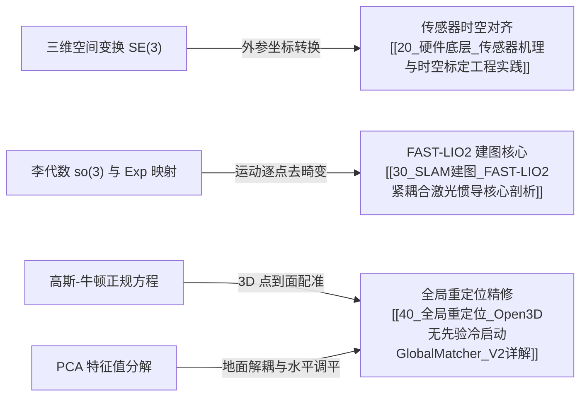

> [!abstract] 本章导读
> SLAM 算法的本质是**在不确定性噪声干扰下，在非线性空间（流形）中寻找机器人位姿的最优估计**。
> 本章系统梳理项目中真正用到的四大数学底座：三维空间刚体变换群 $SE(3)$、李代数 $\mathfrak{so}(3)$ 与流形微积分、高斯-牛顿非线性优化、以及主成分分析（PCA）空间特征拟合。拒绝脱离代码的空洞公式，每一个数学结论均直接映射到 `fast_lio_ws` 中的实现。
>
> 关联总览：[[00_SLAM全栈学习路径与建图项目总览]]

---

## 一、三维空间刚体变换：从 $SO(3)$ 到 $SE(3)$

### 1.1 旋转矩阵与特殊正交群 $SO(3)$

在三维欧几里得空间中，一个纯旋转变换可以用一个 $3 \times 3$ 矩阵 $\mathbf{R}$ 表示。所有旋转矩阵构成**特殊正交群（Special Orthogonal Group）**：
$$SO(3) = \left\{ \mathbf{R} \in \mathbb{R}^{3 \times 3} \;\middle|\; \mathbf{R}^T \mathbf{R} = \mathbf{I}, \; \det(\mathbf{R}) = +1 \right\}$$

- **核心性质**：$\mathbf{R}$ 是正交矩阵，其逆矩阵等于其转置矩阵：
  $$\mathbf{R}^{-1} = \mathbf{R}^T$$
- **冗余性**：一个 $3 \times 3$ 矩阵有 9 个数值，但由于 $\mathbf{R}^T \mathbf{R} = \mathbf{I}$ 提供了 6 个正交归一约束，其实际自由度（DoF）只有 3。如果在优化过程中直接对 9 个元素做加法更新，矩阵的正交性会瞬间被破坏。这就是为什么要引入**李代数**。

---

### 1.2 四元数（Quaternion）及其代数运算

为了克服旋转矩阵存储冗余以及欧拉角（Euler Angles）存在**万向节死锁（Gimbal Lock）**的缺陷，三维旋转常用**单位四元数（Unit Quaternion）**表示：
$$\mathbf{q} = q_w + q_x \mathbf{i} + q_y \mathbf{j} + q_z \mathbf{k} = [s, \; \mathbf{v}]^T, \quad \|\mathbf{q}\| = \sqrt{q_w^2 + q_x^2 + q_y^2 + q_z^2} = 1$$

#### ① Hamilton 四元数乘法
两个四元数相乘代表两次连续旋转：
$$\mathbf{p} \otimes \mathbf{q} = \begin{bmatrix} p_w q_w - \mathbf{p}_v \cdot \mathbf{q}_v \\ p_w \mathbf{q}_v + q_w \mathbf{p}_v + \mathbf{p}_v \times \mathbf{q}_v \end{bmatrix}$$

#### ② 四元数对三维向量进行旋转
给定空间点 $\mathbf{p} \in \mathbb{R}^3$，构造型如 $[0, \mathbf{p}]^T$ 的纯虚四元数，其旋转变换为：
$$\mathbf{p}' = \mathbf{q} \otimes \mathbf{p} \otimes \mathbf{q}^*$$
其中 $\mathbf{q}^* = [q_w, -\mathbf{q}_v]^T$ 为共轭四元数。因为 $\mathbf{q}$ 为单位四元数，所以 $\mathbf{q}^{-1} = \mathbf{q}^*$。

> [!code] 源码映射
> 在 `src/FAST_LIO/src/IMU_Processing.hpp` 中，去畸变时反向补偿激光点的旋转：
> ```cpp
> V3D P_compensate = imu_state.offset_R_L_I.conjugate() * 
>     (imu_state.rot.conjugate() * (R_i * (imu_state.offset_R_L_I * P_i + imu_state.offset_T_L_I) + T_ei) 
>      - imu_state.offset_T_L_I);
> ```
> 此处通过四元数共轭 `.conjugate()` 代替矩阵转置，以极高计算速度完成点云坐标的反向投影。

---

### 1.3 特殊欧氏群 $SE(3)$ 与坐标系树的矩阵反解

刚体变换不仅包含旋转，还包含平移 $\mathbf{t} \in \mathbb{R}^3$。两者构成了**特殊欧氏群（Special Euclidean Group）**：
$$SE(3) = \left\{ \mathbf{T} = \begin{bmatrix} \mathbf{R} & \mathbf{t} \\ \mathbf{0}^T & 1 \end{bmatrix} \in \mathbb{R}^{4 \times 4} \;\middle|\; \mathbf{R} \in SO(3), \; \mathbf{t} \in \mathbb{R}^3 \right\}$$

#### 齐次变换矩阵的逆
$$\mathbf{T}^{-1} = \begin{bmatrix} \mathbf{R}^T & -\mathbf{R}^T \mathbf{t} \\ \mathbf{0}^T & 1 \end{bmatrix}$$

> [!important] 重定位中的核心坐标反解定理
> 在全局重定位成功后，算法算出了机器人在全局地图坐标系下的位姿 $\mathbf{T}_{map\_base}$，但底层里程计维护的是开机局部坐标系 $\mathbf{T}_{odom\_base}$。为了让 ROS 2 TF 树（`map -> odom -> base_link`）闭环，必须发布 $\mathbf{T}_{map\_odom}$：
> $$\mathbf{T}_{map\_odom} = \mathbf{T}_{map\_base} \cdot \mathbf{T}_{odom\_base}^{-1}$$
> 
> 将其分块展开：
> $$\begin{aligned}
> \mathbf{T}_{map\_odom} &= \begin{bmatrix} \mathbf{R}_{m\_b} & \mathbf{t}_{m\_b} \\ \mathbf{0}^T & 1 \end{bmatrix} \begin{bmatrix} \mathbf{R}_{o\_b}^T & -\mathbf{R}_{o\_b}^T \mathbf{t}_{o\_b} \\ \mathbf{0}^T & 1 \end{bmatrix} \\
> &= \begin{bmatrix} \mathbf{R}_{m\_b} \mathbf{R}_{o\_b}^T & \mathbf{t}_{m\_b} - \mathbf{R}_{m\_b} \mathbf{R}_{o\_b}^T \mathbf{t}_{o\_b} \\ \mathbf{0}^T & 1 \end{bmatrix}
> \end{aligned}$$
> **★ 关键工程坑点**：平移分量 $\mathbf{t}_{map\_odom} = \mathbf{t}_{m\_b} - \mathbf{R}_{\Delta} \mathbf{t}_{o\_b}$，**后一项必须左乘相对旋转矩阵 $\mathbf{R}_{\Delta}$**！绝不能直接相减！如果直接标量相减，小车一旦发生偏航旋转，原点就会被甩飞，导致重定位彻底失效。

---

## 二、李群李代数：流形上的微积分与加减算子

### 2.1 为什么需要李代数 $\mathfrak{so}(3)$？

三维旋转群 $SO(3)$ 是一个非线性光滑**流形（Manifold）**，在矩阵加法下**不封闭**（即 $\mathbf{R}_1 + \mathbf{R}_2 \notin SO(3)$）。
这意味着我们无法直接使用传统微积分定义导数：
$$\frac{d f(\mathbf{R})}{d \mathbf{R}} \neq \lim_{\Delta \mathbf{R} \to 0} \frac{f(\mathbf{R} + \Delta \mathbf{R}) - f(\mathbf{R})}{\Delta \mathbf{R}}$$

**解决办法**：李代数 $\mathfrak{so}(3)$ 是 $SO(3)$ 在单位元处的**正切空间（Tangent Space）**，它是一个局部的向量空间（欧几里得空间），在这个空间里支持常规的向量加法。

---

### 2.2 反对称矩阵（Hat 算子）与指数映射

对于任意三维旋转向量 $\boldsymbol{\omega} = [\omega_1, \omega_2, \omega_3]^T \in \mathbb{R}^3$，定义其对应的反对称矩阵（Skew-symmetric Matrix）：
$$[\boldsymbol{\omega}]_\times = \boldsymbol{\omega}^\wedge = \begin{bmatrix} 0 & -\omega_3 & \omega_2 \\ \omega_3 & 0 & -\omega_1 \\ -\omega_2 & \omega_1 & 0 \end{bmatrix} \in \mathfrak{so}(3)$$

从李代数到李群的映射即为**矩阵指数映射（Exponential Map）**。根据泰勒级数展开与反对称矩阵的高阶循环性质，可闭式导出著名的**罗德里格斯公式（Rodrigues' Formula）**：
$$\begin{aligned}
\exp([\boldsymbol{\omega}]_\times) &= \mathbf{I} + [\boldsymbol{\omega}]_\times + \frac{1}{2!} [\boldsymbol{\omega}]_\times^2 + \frac{1}{3!} [\boldsymbol{\omega}]_\times^3 + \dots \\
&= \cos\theta \mathbf{I} + (1 - \cos\theta) \mathbf{a} \mathbf{a}^T + \sin\theta [\mathbf{a}]_\times
\end{aligned}$$
其中 $\theta = \|\boldsymbol{\omega}\|$ 为旋转角弧度，$\mathbf{a} = \boldsymbol{\omega} / \theta$ 为单位旋转轴向量。

---

### 2.3 微小扰动模型与右乘线性化

在激光雷达扫描或 IMU 积分的一个极小时间步长 $\Delta t$ 内，旋转量 $\boldsymbol{\phi} = \boldsymbol{\omega} \Delta t$ 极为微小（$\theta \to 0$）。此时罗德里格斯公式可极佳地作**一阶线性近似**：
$$\exp([\boldsymbol{\phi}]_\times) \approx \mathbf{I} + [\boldsymbol{\phi}]_\times = \begin{bmatrix} 1 & -\phi_z & \phi_y \\ \phi_z & 1 & -\phi_x \\ -\phi_y & \phi_x & 1 \end{bmatrix}$$

变换后的空间点 $\mathbf{p}'$ 可以线性表示为：
$$\mathbf{p}' = \exp([\boldsymbol{\phi}]_\times) \mathbf{p} \approx (\mathbf{I} + [\boldsymbol{\phi}]_\times) \mathbf{p} = \mathbf{p} + \boldsymbol{\phi} \times \mathbf{p} = \mathbf{p} - [\mathbf{p}]_\times \boldsymbol{\phi}$$
这个把叉乘右项变成左乘反对称矩阵的代数变换，是推导 ICP 和卡尔曼滤波雅可比矩阵的核心钥匙！

---

### 2.4 流形上的加减算子（$\boxplus$ 与 $\boxminus$）

在 FAST-LIO2 的核心流形工具箱 `IKFoM_toolkit`（`include/IKFoM_toolkit/esekfom/esekfom.hpp`）中，状态向量并不是简单的数组，而是封装为流形结构。

- **流形加法 $\boxplus$（Encapsulate Exp）**：
  给定流形上的名义旋转 $\mathbf{R} \in SO(3)$ 和切空间扰动量 $\boldsymbol{\delta} \in \mathbb{R}^3$：
  $$\mathbf{R} \boxplus \boldsymbol{\delta} \triangleq \mathbf{R} \cdot \exp([\boldsymbol{\delta}]_\times)$$
- **流形减法 $\boxminus$（Encapsulate Log）**：
  给定两个旋转矩阵 $\mathbf{R}_1, \mathbf{R}_2 \in SO(3)$，求它们在切空间的局部误差向量：
  $$\mathbf{R}_1 \boxminus \mathbf{R}_2 \triangleq \log\left(\mathbf{R}_2^{-1} \mathbf{R}_1\right)^\vee \in \mathbb{R}^3$$

> [!tip] 为什么要用流形加减算子？
> 卡尔曼滤波更新步求解出的是误差状态 $\Delta \mathbf{x}$。传统卡尔曼滤波直接做向量加法 $\mathbf{x}_{k+1} = \mathbf{x}_k + \Delta \mathbf{x}$，但对旋转矩阵直接加数值会导致正交性丧失；采用 $\boxplus$ 算子，更新严格通过李群乘法作用在流形切空间上，保证无论怎么迭代，旋转矩阵始终纯正交！

---

## 三、非线性最小二乘与高斯-牛顿法（Gauss-Newton）

### 3.1 优化目标与残差定义

在三维点云配准（Point-to-Plane ICP）中，给定当前点 $\mathbf{p}_i$、地图最近表面匹配点 $\mathbf{q}_i$ 及其单位表面法向量 $\mathbf{n}_i$（$\|\mathbf{n}_i\| = 1$）。
定义点到面的几何垂直标量残差为：
$$r_i(\mathbf{R}, \mathbf{t}) = \left( \mathbf{R} \mathbf{p}_i + \mathbf{t} - \mathbf{q}_i \right) \cdot \mathbf{n}_i$$
系统总目标函数为最小化所有观测点的残差平方和：
$$\min_{\mathbf{R}, \mathbf{t}} E(\mathbf{R}, \mathbf{t}) = \frac{1}{2} \sum_{i=1}^N \left[ r_i(\mathbf{R}, \mathbf{t}) \right]^2$$

---

### 3.2 雅可比矩阵（Jacobian）详细数学推导

引入流形小扰动 $\Delta \mathbf{x} = \begin{bmatrix} \boldsymbol{\omega} \\ \Delta \mathbf{t} \end{bmatrix} \in \mathbb{R}^6$，其中 $\boldsymbol{\omega} \in \mathfrak{so}(3)$ 为李代数旋转扰动，$\Delta \mathbf{t} \in \mathbb{R}^3$ 为平移扰动。
将扰动应用到点变换上：
$$\mathbf{p}'_i = (\mathbf{I} + [\boldsymbol{\omega}]_\times) \mathbf{p}_i + \Delta \mathbf{t} = \mathbf{p}_i + \boldsymbol{\omega} \times \mathbf{p}_i + \Delta \mathbf{t}$$

代入标量残差公式：
$$\begin{aligned}
r_i(\Delta \mathbf{x}) &\approx \left( \mathbf{p}_i + \boldsymbol{\omega} \times \mathbf{p}_i + \Delta \mathbf{t} - \mathbf{q}_i \right) \cdot \mathbf{n}_i \\
&= \underbrace{(\mathbf{p}_i - \mathbf{q}_i) \cdot \mathbf{n}_i}_{e_i \text{ (当前位姿下的残差)}} + (\boldsymbol{\omega} \times \mathbf{p}_i) \cdot \mathbf{n}_i + \Delta \mathbf{t} \cdot \mathbf{n}_i
\end{aligned}$$

根据向量混合积的轮换对称性：
$$(\boldsymbol{\omega} \times \mathbf{p}_i) \cdot \mathbf{n}_i = (\mathbf{p}_i \times \mathbf{n}_i) \cdot \boldsymbol{\omega} = (\mathbf{p}_i \times \mathbf{n}_i)^T \boldsymbol{\omega}$$

将扰动增量 $\Delta \mathbf{x}$ 完整提取到右侧：
$$r_i(\Delta \mathbf{x}) \approx e_i + \underbrace{\begin{bmatrix} (\mathbf{p}_i \times \mathbf{n}_i)^T & \mathbf{n}_i^T \end{bmatrix}}_{\mathbf{J}_i \in \mathbb{R}^{1 \times 6}} \begin{bmatrix} \boldsymbol{\omega} \\ \Delta \mathbf{t} \end{bmatrix} = e_i + \mathbf{J}_i \Delta \mathbf{x}$$

**雅可比行向量**结构极为清晰优美：
$$\mathbf{J}_i = \begin{bmatrix} (\mathbf{p}_i \times \mathbf{n}_i)_x & (\mathbf{p}_i \times \mathbf{n}_i)_y & (\mathbf{p}_i \times \mathbf{n}_i)_z & n_{ix} & n_{iy} & n_{iz} \end{bmatrix} \in \mathbb{R}^{1 \times 6}$$

---

### 3.3 高斯-牛顿正规方程（Normal Equations）与极速求解

将线性化后的残差代入总目标函数：
$$E(\Delta \mathbf{x}) \approx \frac{1}{2} \sum_{i=1}^N \left( e_i + \mathbf{J}_i \Delta \mathbf{x} \right)^2 = \frac{1}{2} \sum_{i=1}^N \left( e_i^2 + 2 e_i \mathbf{J}_i \Delta \mathbf{x} + \Delta \mathbf{x}^T \mathbf{J}_i^T \mathbf{J}_i \Delta \mathbf{x} \right)$$

对 $\Delta \mathbf{x}$ 求一阶偏导数并令其等于零：
$$\frac{\partial E}{\partial \Delta \mathbf{x}} = \sum_{i=1}^N \mathbf{J}_i^T e_i + \left( \sum_{i=1}^N \mathbf{J}_i^T \mathbf{J}_i \right) \Delta \mathbf{x} = \mathbf{0}$$

整理得到标准的**高斯-牛顿正规方程**：
$$\mathbf{H} \Delta \mathbf{x} = \mathbf{b}$$
其中：
- **Hessian 近似矩阵**：$\mathbf{H} = \sum_{i=1}^N \mathbf{J}_i^T \mathbf{J}_i \in \mathbb{R}^{6 \times 6}$（对称半正定矩阵）
- **梯度向量**：$\mathbf{b} = - \sum_{i=1}^N \mathbf{J}_i^T e_i \in \mathbb{R}^{6 \times 1}$

> [!tip] 极速数值求解
> 由于 $\mathbf{H}$ 仅仅是一个 $6 \times 6$ 的对称正定小矩阵，通过 Eigen 库提供的 **LLT（Cholesky 分解）** 或 **LDLT**：
> ```cpp
> Eigen::Vector6d delta_x = H.ldlt().solve(b);
> ```
> 求解一次仅需微秒级时间，迭代 15~25 次即可高精收敛。

---

## 四、主成分分析（PCA）与空间几何特征拟合

在三维点云处理中，判断一组点是否共面、并精确解算该微平面的法向量 $\mathbf{n}$ 和平面常数 $d$，是 FAST-LIO2 面特征拟合与重定位地面解耦的基石。

### 4.1 样本协方差矩阵（Covariance Matrix）构建

给定空间中邻近的 $K$ 个点集 $\mathcal{P} = \{\mathbf{p}_1, \mathbf{p}_2, \dots, \mathbf{p}_K\}$（例如 FAST-LIO2 中取 $K=5$ 近邻）。
1. 计算点集的三维几何几何质心（Centroid）：
   $$\bar{\mathbf{p}} = \frac{1}{K} \sum_{j=1}^K \mathbf{p}_j$$
2. 计算去中心化后的样本协方差矩阵 $\mathbf{\Sigma} \in \mathbb{R}^{3 \times 3}$：
   $$\mathbf{\Sigma} = \frac{1}{K} \sum_{j=1}^K (\mathbf{p}_j - \bar{\mathbf{p}}) (\mathbf{p}_j - \bar{\mathbf{p}})^T$$

---

### 4.2 特征值分解与几何物理意义

由于 $\mathbf{\Sigma}$ 是实对称矩阵，其特征值分解必定存在 3 个非负实特征值及互相正交的特征向量：
$$\mathbf{\Sigma} \mathbf{v}_i = \lambda_i \mathbf{v}_i \quad (i = 0, 1, 2), \quad 0 \le \lambda_0 \le \lambda_1 \le \lambda_2$$

每个特征值与特征向量具有明确的空间物理含义：

| 特征量 | 几何含义 | 点云局部形态判断 |
| :--- | :--- | :--- |
| $\lambda_2, \mathbf{v}_2$ | 点云离散程度最大的主方向 | 决定平面的第一展布主轴 |
| $\lambda_1, \mathbf{v}_1$ | 点云离散程度次大的方向 | 决定平面的第二展布主轴 |
| **$\lambda_0, \mathbf{v}_0$** | **点云离散程度最小的方向（厚度）** | **★ 最小特征值对应的特征向量 $\mathbf{v}_0$ 即为该平面的最佳法向量 $\mathbf{n}$！** |

- **平面性检验准则**：
  若点集分布在一个平整表面上，则法向厚度 $\lambda_0$ 应该远小于表面展布 $\lambda_1$：
  $$\lambda_0 \ll \lambda_1 \approx \lambda_2$$
  在 FAST-LIO2 中，若拟合残差 $\sqrt{\lambda_0} > 0.1\text{m}$，则判定为粗糙噪点而非平面，直接丢弃该观测。

> [!code] 源码映射：重定位中的 PCA 地面调平
> 摘自 `src/open3d_loc/src/open3d_registration/global_matcher.cpp` 中 `EstimateFloorAndLeveling`：
> ```cpp
> Eigen::SelfAdjointEigenSolver<Eigen::Matrix3d> es(cov);
> Eigen::Vector3d normal = es.eigenvectors().col(0); // 最小特征值对应的第 0 列特征向量
> if (normal.z() < 0) normal = -normal; // 统一朝上
> 
> // 若法向量与 Z 轴夹角在 12° 阈值内，构建四元数消除水平倾角
> if (normal.z() > std::cos(12.0 * M_PI / 180.0)) {
>     R_level_out = Eigen::Quaterniond::FromTwoVectors(normal, Eigen::Vector3d::UnitZ()).toRotationMatrix();
> }
> ```
> 此处通过几行优雅的特征值分解，全自动解算出实车停在地面时的绝对重力倾角，彻底消除了开机姿态倾斜造成的投影变形。

---

## 五、数学底座在全系统的映射串联



掌握了本章的坐标变换、李代数小扰动与高斯-牛顿方程，后续建图与重定位的代码将不再是难以捉摸的黑盒，而是这几行经典数学公式在现代 C++ 中的优雅投射。

