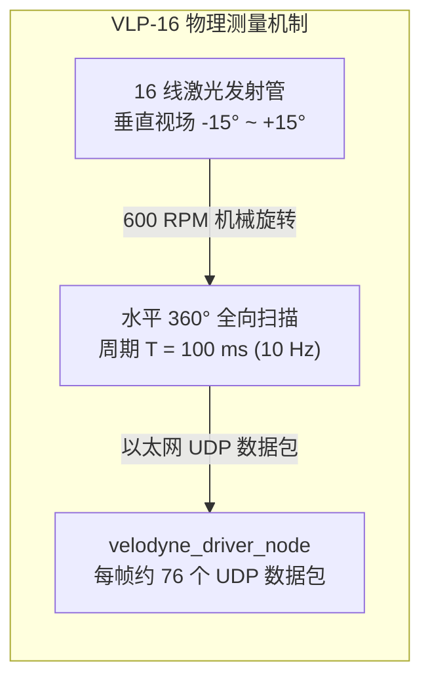
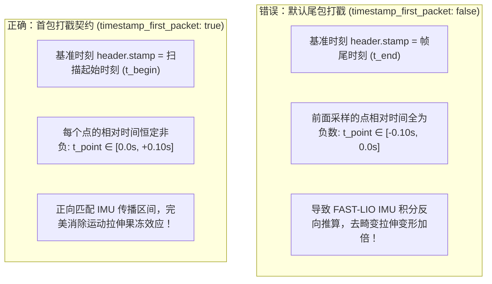
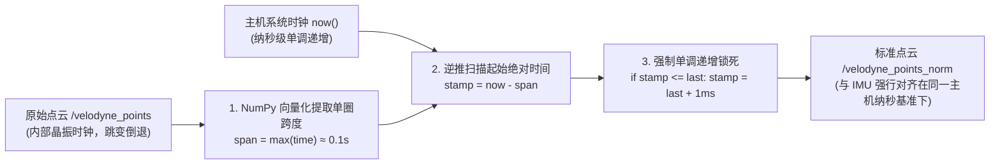
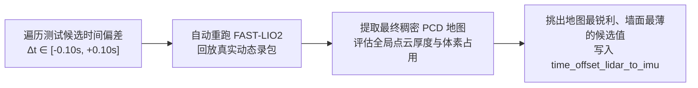

> [!abstract] 本章导读
> **“Garbage In, Garbage Out”** 是 SLAM 工程界永恒的真理。在实际机器人项目中，超过 80% 的建图漂移、重影、分层甚至程序崩溃，其根源根本不是 SLAM 算法的数学推导有误，而是输入算法的原始传感器数据存在**时间戳倒退、时间域不同步、硬件参数错配或空间外参反向**。
> 本章系统总结 Velodyne VLP-16 激光雷达与超核 HI12 九轴 IMU 的物理机理、驱动级时间戳契约、自研软件时钟单调对齐机制，以及高精空间外参与时间偏移标定方法。
> 
> 关联总览：[[00_SLAM全栈学习路径与建图项目总览]]

---

## 一、传感器物理机理与驱动关键配置

### 1.1 Velodyne VLP-16 机械旋转激光雷达

Velodyne Puck (VLP-16) 内部拥有 16 对红外激光发射与接收管，安装在垂直夹角覆盖 $-15^\circ \sim +15^\circ$（垂直角分辨率 $2^\circ$）的旋转光学本体上。



#### ① 核心参数指标
- **转速设定**：$600\text{ RPM}$（每秒旋转 10 圈，扫描周期 $T \approx 100\text{ms}$，发布频率 $10\text{Hz}$）；
- **水平角分辨率**：$\Delta \theta = 360^\circ / (10\text{Hz} \times \text{点数}) \approx 0.1^\circ \sim 0.2^\circ$；
- **每帧点数规模**：单圈约发布 $28,000 \sim 30,000$ 个三维激光点。

#### ② ★ 致命配置陷阱 1：双回波（Dual Return）误开启
- **现象**：终端查看 `ros2 topic hz /velodyne_points` 显示帧率高达 $20\text{Hz}$ 甚至 $40\text{Hz}$，但在 RViz 里看点云每帧只有 $90^\circ$ 扇形残片。
- **根因**：雷达 Web 界面配置成了 `returns: Dual`（双回波模式，记录首个击中物与最远击中物）。驱动为了吐出两倍数据量，会将点云切割为多个碎片包。
- **解决**：在浏览器访问雷达 IP（或执行 `curl --noproxy '*' -s http://192.168.1.201/cgi/settings.json`），将 Return Type 强制锁死为 **`Strongest`（最强单回波）**。

---

### 1.2 超核电子 HI12 九轴 IMU

HI12 是高集成度九轴惯性测量单元，内含三轴 MEMS 陀螺仪、三轴 MEMS 加速度计和三轴磁力计，通过串口（USB-to-UART）与主机小主机通信。

#### ① 物理测量方程
- **比力方程（加速度计）**：
  $$\mathbf{a}_{meas} = \mathbf{a}_{motion} - \mathbf{g} + \mathbf{b}_a + \mathbf{n}_a$$
  > [!important] 为什么静止时 $a_z \approx +9.8\text{ m/s}^2$？
  > 加速度计内部是通过弹簧微机电结构感知质量块的**支撑反作用力**。当机器人静止放在水平桌面上时，桌面对传感器的向上支持力抵消了重力，因此加速度计读数必然是**垂直向上 $+9.8\text{ m/s}^2$**，而不是 $0$ 或 $-9.8$。在配置中必须确认单位为 $\text{m/s}^2$ 而不是 $g$ 制。
- **角速度方程（陀螺仪）**：
  $$\boldsymbol{\omega}_{meas} = \boldsymbol{\omega}_{motion} + \mathbf{b}_g + \mathbf{n}_g$$
  其中 $\mathbf{b}_g$ 为零偏（Bias），若开机时未静止导致零偏估错，整个建图过程将持续累积旋转发散。

#### ② 采样率与波特率的带宽法则
- **要求**：为了高精捕捉机械臂/足式狗跑动时的剧烈震动并为点云去畸变提供充足支持，IMU 采样率必须提升至 **$200\text{Hz}$**（$5\text{ms}$ 一包数据）；
- **波特率计算**：
  $115200\text{ baud}$ 的实际有效字节带宽仅约 $11.5\text{ KB/s}$。一个包含九轴浮点数据、校验码的二进制协议包若按 $200\text{Hz}$ 发送，极易发生串口 FIFO 溢出导致静默丢包。
- **必须配置**：在超核 CHCenter 上位机中将串口波特率升级为 **$230400\text{ baud}$**。

---

## 二、驱动级首包时间戳契约（First Packet Stamping）

激光雷达旋转一圈耗时 $100\text{ms}$。对于旋转中采样的每一个点 $\mathbf{p}_i$，其发射时刻相对于这帧点云基准时刻的相对时间偏移量记为 $t_{point} \in \mathbb{R}$。



> [!code] 配置文件参数核验
> 在 `src/FAST_LIO/config/velodyne_driver.yaml` 与 `velodyne.yaml` 中，以下两项具有决定性意义：
> ```yaml
> timestamp_first_packet: true   # 强制以首包到达时刻作为一圈点云的基准时间戳
> timestamp_unit: 0              # 0 代表秒/微秒标准时间单位
> ```
> 可以通过运行工作区工具 `python3 ~/fast_lio_ws/tools/check_point_time.py` 进行单点校验，必须确保点云字段内含 `time` 且全部分布在 $[0.0, 0.10]\text{ s}$ 内。

---

## 三、软件时钟对齐神技：统一主机时基与强制单调递增

在没有外部 GPS / PPS 硬件秒脉冲硬对时的高性价比机器人系统中，**激光雷达硬件内部晶振**与**小主机（香橙派/工控机系统时钟）**各走各的，两者存在严重的动态漂移。

### 3.1 真实实测痛点：100 秒发生 6 次时间倒退

在本项目前期实测中，未接入主机对齐时，VLP-16 内部自由振荡时钟在 100 秒内发生了 **6 次时间戳骤降倒退**，最大一次倒退幅度高达 **$-1748\text{ ms}$**。
- **对 FAST-LIO 的毁灭性打击**：
  FAST-LIO 在 `src/laserMapping.cpp` 中维护点云时间缓存，一旦发现：
  ```cpp
  if (!is_first_lidar && cur_time < last_timestamp_lidar) {
      std::cerr << "lidar loop back, clear buffer" << std::endl;
      lidar_buffer.clear();
  }
  ```
  时间倒退会强制清空全部历史点云与 IMU 缓存，导致里程计瞬间跟丢、位姿飞出天际！

---

### 3.2 破解方案：`timestamp_normalizer.py` 核心实现

我们设计了一个无状态极速介入节点 `tools/timestamp_normalizer.py`，采用**三步向量化重打戳与单调对齐机制**：



> [!code] 核心代码逐行赏析（`tools/timestamp_normalizer.py`）
> ```python
> def _time_span(msg: PointCloud2):
>     """读取一帧点云里 time 字段的最大值 (NumPy 内存视图，1.7万点耗时仅 0.8ms)"""
>     off = next((f.offset for f in msg.fields if f.name == 'time'), None)
>     n = msg.width * msg.height
>     need = n * msg.point_step
>     a = np.frombuffer(bytes(msg.data[:need]), dtype=np.uint8).reshape(n, msg.point_step)
>     t = a[:, off:off + 4].copy().view(np.float32).reshape(-1)
>     t = t[np.isfinite(t)]
>     return float(t.max()) if t.size > 0 else 0.1
> 
> def on_cloud(self, msg: PointCloud2):
>     now = self.get_clock().now().nanoseconds * 1e-9  # 当前主机纳秒级时钟
>     span = self._time_span(msg)
>     
>     # 核心公式：点云转完一圈才被主机接收到，而起始时刻应为接收时刻倒退一圈耗时
>     stamp = now - span
> 
>     # ★ 强制单调对齐：消除网络微小抖动，永不产生时间回退
>     if self.last_out is not None and stamp <= self.last_out:
>         stamp = self.last_out + 0.001
>         self.forced += 1
>     self.last_out = stamp
> 
>     # 重新打戳后发布
>     sec = int(stamp)
>     msg.header.stamp.sec = sec
>     msg.header.stamp.nanosec = int((stamp - sec) * 1e9)
>     self.pub.publish(msg)
> ```

> [!warning] 为什么回放录包绝不能加 `--clock`？
> 如果用 `ros2 bag record` 录制了带时间跳变的原始数据，回放时若加 `--clock` 并开启 `use_sim_time:=true`，ROS2 会用包里带跳变的时钟作为系统时钟，导致 `timestamp_normalizer.py` 内部计算的 `now()` 跟着跳变，彻底白修！
> **正确做法**：回放时不加 `--clock`，全链路统一依赖当前主机的墙钟（Wall Time），实测时间倒退从 **31 次彻底降为 0 次**！

---

## 四、空间刚体外参标定（Extrinsic Calibration）

外参包括从激光雷达坐标系到 IMU 坐标系的刚体平移向量 $\mathbf{p}_{L}^I \in \mathbb{R}^3$ 与旋转矩阵 $\mathbf{R}_{L}^I \in SO(3)$：
$$\mathbf{p}_{imu} = \mathbf{R}_{L}^I \mathbf{p}_{lidar} + \mathbf{p}_{L}^I$$

### 4.1 平移外参量测（`extrinsic_T`）
通过游标卡尺精确量取从 **LiDAR 光学中心（腰部发射缝隙）到 IMU 芯片几何中心** 的相对位移向量（单位：米）。
在本项目结构件中，IMU 贴装于激光雷达上方 $45.5\text{ mm}$ 处，水平对中良好，因此标定结果为：
$$\mathbf{p}_{L}^I = \begin{bmatrix} 0.0, & 0.0, & -0.0455 \end{bmatrix}^T$$

---

### 4.2 旋转外参快速四象限决策表（`extrinsic_R`）

旋转外参若存在轴向定义错误，会导致小车向前运动时算法误以为在向上平移，位姿瞬间发散。
我们总结了一套无需外部昂贵动捕设备、仅靠双手动作即可在 30 秒内锁死轴系的**两动决策法**：

运行观察工具：`python3 ~/fast_lio_ws/tools/imu_live.py 60`

1. **动作 1（低头）**：将激光雷达正面（出线口正前方）朝下倾斜约 $30^\circ$；
2. **动作 2（逆时针俯视旋转）**：从上方俯视逆时针水平转动雷达本体。

| 低头时明显变负的加速度分量 | 俯视逆时针转时的角速度 | IMU 机体对应轴系 | extrinsic_R（按行展开） |
| :--- | :--- | :--- | :--- |
| **`ax`** | **$\omega_z > 0$** | **X前 Y左 Z上（与雷达完全同向）** | **`1, 0, 0, 0, 1, 0, 0, 0, 1`（单位阵）** |
| `ay` | $\omega_z > 0$ | X右 Y前 Z上 | `0, -1, 0, 1, 0, 0, 0, 0, 1` |
| `ax` 变正 | $\omega_z > 0$ | X后 Y左 Z上（绕 Z 转 180°） | `-1, 0, 0, 0, -1, 0, 0, 0, 1` |
| `ay` 变正 | $\omega_z > 0$ | X左 Y后 Z上 | `0, 1, 0, -1, 0, 0, 0, 0, 1` |

通过脚本一键写入参数配置：
```bash
python3 ~/fast_lio_ws/tools/set_extrinsic.py --t 0.0 0.0 -0.0455 --r 1,0,0,0,1,0,0,0,1
```

---

## 五、时间偏移（Time Offset）网格扫描标定

### 5.1 物理本质与运动涂抹模型

激光雷达数据经以太网 UDP 驱动协议栈解析，IMU 数据经 USB-to-UART 芯片驱动解析，二者到达内存存在数毫秒到数十毫秒的**固定时间滞后偏差 $\Delta t = t_{lidar} - t_{imu}$**。
当机器人发生剧烈旋转角速度 $\boldsymbol{\omega}$ 时，如果时间戳没有补偿该固定偏移 $\Delta t$，去畸变算法投影的空间点就会产生切向涂抹位移：
$$\text{Error}_{\text{blur}} \approx \|\boldsymbol{\omega}\| \cdot \Delta t \cdot r$$
其中 $r$ 为障碍物离雷达的距离。若 $\Delta t = 20\text{ms}$，在小车以 $1.5\text{rad/s}$ 快速转弯时，远处 $5\text{m}$ 外的墙面将被涂抹厚度高达 $15\text{cm}$，形成严重的双层重影。



---

### 5.2 动态包录制规范与初始化硬约束

使用工作区脚本 `tools/scan_time_offset.py` 进行标定，对录包过程有极严格的物理操作要求：

> [!important] 为什么开头必须严格静止 3~5 秒？
> FAST-LIO2 在开机第一帧时，提取前 20 个 IMU 数据包（约 100ms）执行初始化（见 `src/FAST_LIO/src/IMU_Processing.hpp:193-196`）：
> 1. $\text{grav} = - \text{mean\_acc} / \|\text{mean\_acc}\| \cdot 9.81$：若开头在晃动，**重力加速度方向被算歪，整张地图会整体倾斜**！
> 2. $\mathbf{b}_g = \text{mean\_gyr}$：将开头的角速度均值当成陀螺仪零偏！若小车在动，算法会**把正常的转弯运动当成传感器误差全部减去**！
> 开头在动会导致后续每个候选 offset 全都错得一模一样，标定彻底失真。

- **动态段运动要求**：
  在静止 5 秒后，手持雷达做平滑但剧烈的左右旋转运动，保证角速度 95 分位数 **$P_{95}\|\boldsymbol{\omega}\| > 0.5\text{ rad/s}$**。
  若角速度过小（如小车慢速平移），涂抹信号被点云测距高斯噪声淹没，扫描曲线将是一条水平死线，无法确定最优极小值。

---

## 六、硬件底层标定工程交付清单

完成本章全套标定后，传感器底层交付给上层建图系统的将是一个**确定、纳秒级单调、刚体外参准确且运动无畸变的黄金数据流**：

| 交付项 | 验证指标 | 检验命令 |
| :--- | :--- | :--- |
| **激光点云频率** | $9.9 \sim 10.3\text{ Hz}$（无丢包跳帧） | `ros2 topic hz /velodyne_points_norm` |
| **逐点时间戳** | 字段包含 `time` 且 $t_i \in [0.0, 0.10]\text{ s}$ 恒非负 | `python3 tools/check_point_time.py` |
| **IMU 数据流** | 频率 $\approx 194 \sim 200\text{ Hz}$，静止时 $\|\mathbf{a}\| \approx 9.8\text{ m/s}^2$ | `python3 tools/check_pipeline.py` |
| **时钟回退现象** | `lidar loop back` 报警发生次数严格为 **0 次** | 观察 `fastlio_mapping` 运行日志 |
| **静止漂移** | 持续运行 30 秒静止漂移 $< 0.05\text{ m}$ | `python3 tools/check_pipeline.py` |

数据流准备就绪后，下一步即可正式驱动 FAST-LIO2 算法核心进行高精度三维激光惯导建图：[[30_SLAM建图_FAST-LIO2紧耦合激光惯导核心剖析]]。

