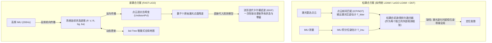
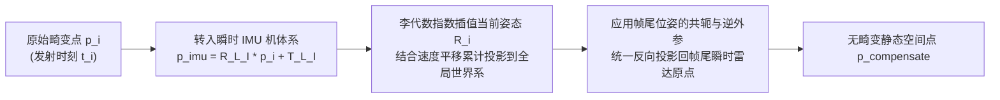
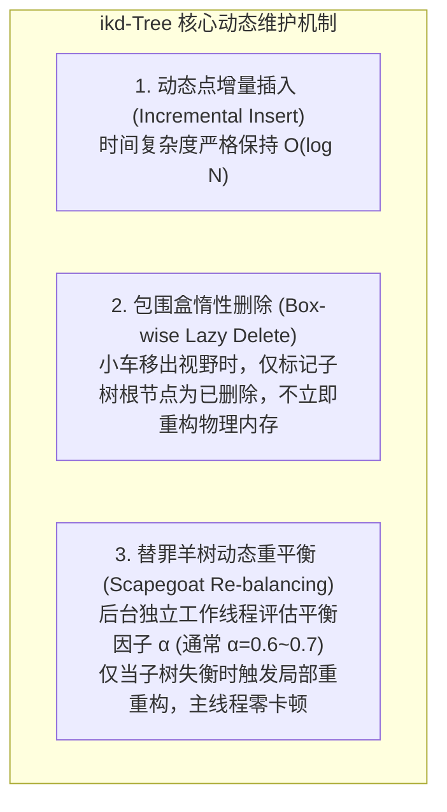

> [!abstract] 本章导读
> **FAST-LIO2（Fast LiDAR-Inertial Odometry）** 是香港大学火星实验室（HKU MaRS Lab）开源的高性能紧耦合激光惯导里程计，也是目前机器人定位与三维建图领域的标杆框架之一。
> 本章深入源码底层，彻底拆解其四大核心支柱：**IMU 前向传播与运动去畸变（Deskewing）**、**增量式 `ikd-Tree` 空间索引**、**流形迭代卡尔曼滤波（IEKF）与维数翻转公式**，并针对**室内狭窄小空间建图拟合退化**给出实测调优经验。
> 
> 关联总览：[[00_SLAM全栈学习路径与建图项目总览]]

---

## 一、系统架构：紧耦合 vs 松耦合

在激光与惯导融合的发展历程中，主要经历了两次重大范式转移：



- **松耦合致命缺陷**：若机器人在狭长走廊中沿水平方向滑行，激光前端发生几何退化，此时松耦合算法依然会输出一个充满错误方差的位姿估计，强行喂入后端导致整车坐标漂移。
- **FAST-LIO2 紧耦合优势**：激光点云不再先解算独立位姿，而是**直接把每个激光点的点到面标量距离作为卡尔曼滤波的一个单维观测**。若某一维度退化，该方向的残差天然不提供更新增益，系统自动平滑退化为纯 IMU 积分，鲁棒性产生质的飞跃。

---

## 二、IMU 前向传播与点云逐点后向去畸变（Deskewing）

### 2.1 运动畸变（果冻效应）的几何起因

旋转式激光雷达发射一圈激光耗时 $100\text{ms}$。如果小车在这 $100\text{ms}$ 内以 $1.0\text{m/s}$ 运动或以 $1.0\text{rad/s}$ 急转弯：
- 这一圈开头的点在坐标系 $A$ 采样；
- 这一圈中间的点在坐标系 $B$ 采样；
- 这一圈结尾的点在坐标系 $C$ 采样。
若强行将它们视作同一瞬间静止发射并拼在一张点云里，原本平直的实验室墙面将被拉扯成弯曲的弧面，这就是**运动畸变（Motion Distortion）**。

---

### 2.2 前向传播（Forward Propagation）状态递推

在两帧激光点云到达的间隙，FAST-LIO2 依靠高频 IMU（$200\text{Hz}$）进行名义状态的中值积分递推。

在时间区间 $[t_k, t_{k+1}]$ 内（对应连续两个 IMU 数据包）：
$$\Delta t = t_{k+1} - t_k, \quad \bar{\boldsymbol{\omega}} = \frac{\boldsymbol{\omega}_k + \boldsymbol{\omega}_{k+1}}{2} - \mathbf{b}_g, \quad \bar{\mathbf{a}} = \frac{\mathbf{a}_k + \mathbf{a}_{k+1}}{2} - \mathbf{b}_a$$

名义状态递推方程：
$$\begin{aligned}
\mathbf{R}_{k+1} &= \mathbf{R}_k \cdot \exp([\bar{\boldsymbol{\omega}} \Delta t]_\times) \\
\mathbf{v}_{k+1} &= \mathbf{v}_k + \left( \mathbf{R}_k \bar{\mathbf{a}} + \mathbf{g} \right) \Delta t \\
\mathbf{p}_{k+1} &= \mathbf{p}_k + \mathbf{v}_k \Delta t + \frac{1}{2} \left( \mathbf{R}_k \bar{\mathbf{a}} + \mathbf{g} \right) \Delta t^2
\end{aligned}$$

同时递推误差状态协方差矩阵 $\mathbf{P}_{k+1} = \mathbf{F}_{\mathbf{x}} \mathbf{P}_k \mathbf{F}_{\mathbf{x}}^T + \mathbf{F}_{\mathbf{w}} \mathbf{Q} \mathbf{F}_{\mathbf{w}}^T$。

---

### 2.3 后向运动去畸变（`UndistortPcl`）数学推导与代码落地

当整帧点云所有激光点接收完毕后，算法将每个点从其发射时刻 $t_i$ 的雷达瞬时局部系，反向投影到**该帧扫描结束时刻（$t_{\text{end}}$）统一的雷达坐标系**。



> [!code] 源码深度精读：`src/FAST_LIO/src/IMU_Processing.hpp` 中的 `UndistortPcl`
> ```cpp
> auto it_pcl = pcl_out.points.end() - 1;
> // 从尾部向前遍历 IMU 姿态队列
> for (auto it_kp = IMUpose.end() - 1; it_kp != IMUpose.begin(); it_kp--)
> {
>     auto head = it_kp - 1;
>     auto tail = it_kp;
>     R_imu << MAT_FROM_ARRAY(head->rot);
>     vel_imu << VEC_FROM_ARRAY(head->vel);
>     pos_imu << VEC_FROM_ARRAY(head->pos);
>     acc_imu << VEC_FROM_ARRAY(tail->acc);
>     angvel_avr << VEC_FROM_ARRAY(tail->gyr);
> 
>     // 匹配点云发射时刻落在当前 IMU 区间内的所有激光点
>     for (; it_pcl->curvature / double(1000) > head->offset_time; it_pcl--)
>     {
>         double dt = it_pcl->curvature / double(1000) - head->offset_time;
> 
>         // 1. 李代数指数映射插值：求解打在该点那一瞬间的绝对旋转矩阵 R_i
>         M3D R_i(R_imu * Exp(angvel_avr, dt));
>         V3D P_i(it_pcl->x, it_pcl->y, it_pcl->z);
> 
>         // 2. 求解打在该点瞬间的世界系平移位移相对于帧尾原点的累计相对平移 T_ei
>         V3D T_ei(pos_imu + vel_imu * dt + 0.5 * acc_imu * dt * dt - imu_state.pos);
> 
>         // 3. 核心刚体反向补偿公式：
>         // 先用外参转到 IMU，再转到世界，减去帧尾平移，最后乘以帧尾逆姿态与逆外参
>         V3D P_compensate = imu_state.offset_R_L_I.conjugate() * 
>             (imu_state.rot.conjugate() * (R_i * (imu_state.offset_R_L_I * P_i + imu_state.offset_T_L_I) + T_ei) 
>              - imu_state.offset_T_L_I);
> 
>         // 覆盖原始坐标为去除果冻效应后的真实空间坐标
>         it_pcl->x = P_compensate(0);
>         it_pcl->y = P_compensate(1);
>         it_pcl->z = P_compensate(2);
> 
>         if (it_pcl == pcl_out.points.begin()) break;
>     }
> }
> ```

---

## 三、增量式 KD-Tree（`ikd-Tree`）：动态空间索引的秘密

传统基于 PCL 的激光 SLAM 方案（如 LOAM、LeGO-LOAM）通常需要维护一个滑动窗口局部地图，每当机器人走出一段距离，就必须从头把数万个点重新构建一次静态 KD-Tree，耗时高达 $50 \sim 100\text{ms}$，直接拖垮 CPU 实时性。

FAST-LIO2 专门设计了支持**动态在线增量插入、包围盒（Box-wise）惰性删除与后台自动重平衡**的 **`ikd-Tree`**。



- **点到面近邻搜索效率**：
  在稠密数万点地图中，单次 5 近邻搜索耗时稳定在 **$10 \sim 30\text{ \mu s}$**，为千级特征点直接参与 IEKF 迭代提供了算力保证。

---

## 四、流形上的迭代误差状态卡尔曼滤波（IEKF）与维数翻转公式

### 4.1 观测模型与 5 近邻平面拟合

去畸变后的点云经过体素下采样得到 $M$ 个特征点。对于每一个世界坐标系下的点 $\mathbf{p}_i^w$：
1. 在 `ikd-Tree` 中快速检索离它欧氏距离最近的 $K=5$ 个邻近地图点；
2. 利用上一章讲述的 [[10_数学底座_三维刚体变换_李代数与流形优化#四、主成分分析（PCA）与空间几何特征拟合|PCA 协方差特征值分解]]，求解该局部的拟合平面方程：
   $$\mathbf{n}^T \mathbf{q} + d = 0 \quad (\|\mathbf{n}\| = 1)$$
3. 验证平面拟合质量：若 5 个邻近点到该平面的最大距离小于阈值（$0.1\text{m}$），则该点被选定为有效平面观测点；
4. 标量点到面距离观测残差即为：
   $$r_i = \mathbf{n}^T \mathbf{p}_i^w + d = \mathbf{n}^T \left( \mathbf{R} (\mathbf{R}_L^I \mathbf{p}_i^L + \mathbf{p}_L^I) + \mathbf{p} \right) + d$$

---

### 4.2 ★ FAST-LIO2 最硬核突破：卡尔曼增益维数翻转（Woodbury Identity）

这是 FAST-LIO2 能够将数千点云直接进行滤波、算力超越传统方法数十倍的最核心数学机密！

#### ① 传统卡尔曼滤波的标准增益公式与性能瓶颈
设状态向量维数为 $n$（在 FAST-LIO2 中 $n=18$，包含位姿、速度、零偏与重力），激光特征观测点数量为 $M$（每个点提供 1 维标量残差，总观测维数 $m = M \approx 1000 \sim 3000$）：
$$\mathbf{K} = \mathbf{P} \mathbf{H}^T \left( \mathbf{H} \mathbf{P} \mathbf{H}^T + \mathbf{R} \right)^{-1}$$

- **致命痛点**：注意括号内的待求逆矩阵 $\left( \mathbf{H} \mathbf{P} \mathbf{H}^T + \mathbf{R} \right)$！
  其维度是 **$m \times m$**（即 $2000 \times 2000$ 的超大矩阵）！
  对一个 $2000$ 维矩阵进行求逆运算，时间复杂度为 $\mathcal{O}(m^3)$，在嵌入式小主机 CPU 上需要耗时数百毫秒甚至数秒，根本无法实时建图！因此传统 LOAM 必须极其苛刻地抽稀曲率特征点，仅保留几十个角点和面点。

#### ② 矩阵求逆引理（维数反转推导）
根据矩阵逆引理（Woodbury Matrix Identity）与卡尔曼增益的代数等价变形：
$$\mathbf{K} = \left( \mathbf{H}^T \mathbf{R}^{-1} \mathbf{H} + \mathbf{P}^{-1} \right)^{-1} \mathbf{H}^T \mathbf{R}^{-1}$$

- **降维奇迹**：
  让我们重新审视待求逆的矩阵 $\left( \mathbf{H}^T \mathbf{R}^{-1} \mathbf{H} + \mathbf{P}^{-1} \right)$！
  - $\mathbf{H} \in \mathbb{R}^{m \times n}$，则 $\mathbf{H}^T \mathbf{R}^{-1} \mathbf{H} \in \mathbb{R}^{n \times n}$；
  - 待求逆矩阵的维度**从 $m \times m$ 彻底暴跌为 $n \times n$**！
  - 在 FAST-LIO2 中，$n$ 是固定的常数（$n=18$），哪怕输入 10,000 个激光点，$n \times n$ 永远只是一个 **$18 \times 18$ 的袖珍小矩阵**！
  - 求解一个 $18 \times 18$ 矩阵的逆仅需微秒级时间！

> [!important] 为什么 FAST-LIO2 极其丝滑？
> 这一数学翻转将计算复杂度从与特征点数三次方相关的 $\mathcal{O}(m^3)$ 彻底斩断为与点数呈严格线性的 $\mathcal{O}(m \cdot n^2)$。这就是为什么 FAST-LIO2 可以彻底抛弃复杂的特征工程，直接把体素滤波后的全量点云一股脑扔进 IEKF，在香橙派/小主机上依然能轻松跑出 $20\text{Hz} \sim 40\text{Hz}$！

---

## 五、室内狭窄空间建图避坑调参复盘

在实际工程落地中，许多同学直接使用 GitHub 开源仓库默认的 `velodyne.yaml` 配置，结果在室内小实验室建图时遭遇惨痛失败。

### 5.1 惨痛现象复盘：为什么小房间建图容易飞掉？

- **错误表现**：在室内走廊转弯或小房间掉头时，终端疯狂刷屏：
  `[diag] NoEffective! few_neighbors=... plane_or_residual_fail=...`
  紧接着点云地图开始漂移、出现双层墙重影，最终位姿彻底飞掉。

- **根因解剖**：
  默认配置是针对室外大开阔道路调的：
  ```yaml
  filter_size_surf: 0.5   # 体素滤波 0.5m
  filter_size_map: 0.5    # 地图体素 0.5m
  point_filter_num: 3     # 采样跳点
  ```
  在仅有 3~5 米宽的小房间里，一堵墙体一共只有几米长。按 $0.5\text{m}$ 体素下采样后，整面墙只剩下十几个点。在每次更新时，5 近邻搜索搜到的点彼此相距过远，往往跨越了窗框、桌面和墙体棱角，根本无法满足平面拟合阈值，导致有效平面点数（`effct_feat_num`）降为 0！卡尔曼滤波没有测量约束，只能依赖 IMU 盲走，瞬间漂移。

---

### 5.2 黄金室内调优参数对照表

经过本项目在实际室内环境反复迭代验证，调整为以下经验参数后，建图效果达到极高几何锐利度：

| 参数项 | 开源默认值（室外大场景） | **本项目实战调优值（室内空间）** | 物理含义与改动理由 |
| :--- | :--- | :--- | :--- |
| `filter_size_surf` | `0.5 m` | **`0.15 m ~ 0.20 m`** | 提高当前帧点云分辨率，保留室内机柜、立柱与平整墙体微元 |
| `filter_size_map` | `0.5 m` | **`0.25 m ~ 0.30 m`** | 提升全局 ikd-Tree 存储精细度，防止小拐角几何骨架被抹平 |
| `point_filter_num` | `2 ~ 3` | **`1`** | **严禁跳点！** 逐点保留原始线束特征，确保 5 近邻搜索必定命中同平面 |
| `gyr_cov` | `0.1` | **`0.05`** | 超核 HI12 实测零漂极小，收紧陀螺仪方差防止小车转弯时姿态虚晃 |
| `b_gyr_cov` | `0.0001` | **`0.00005`** | 锁紧陀螺仪零偏随机游走方差，增强长周期直行稳定性 |

---

## 六、建图成果交付与持久化保存

当小车在实验室巡航闭环一圈后，点云墙面严丝合缝（静止漂移 $< 0.05\text{m}$）。在节点中配置 `pcd_save.pcd_save_en: true` 或调用 `/map_save` 服务，系统将完整的全局高精度三维点云持久化保存为 `.pcd` 文件（例如 `maps/map_1021_1050.pcd`）。

这份 `.pcd` 先验地图完整记录了建筑环境的全局几何骨架，接下来将直接作为开机零先验全局重定位的核心基准底图：[[40_全局重定位_Open3D无先验冷启动GlobalMatcher_V2详解]]。

