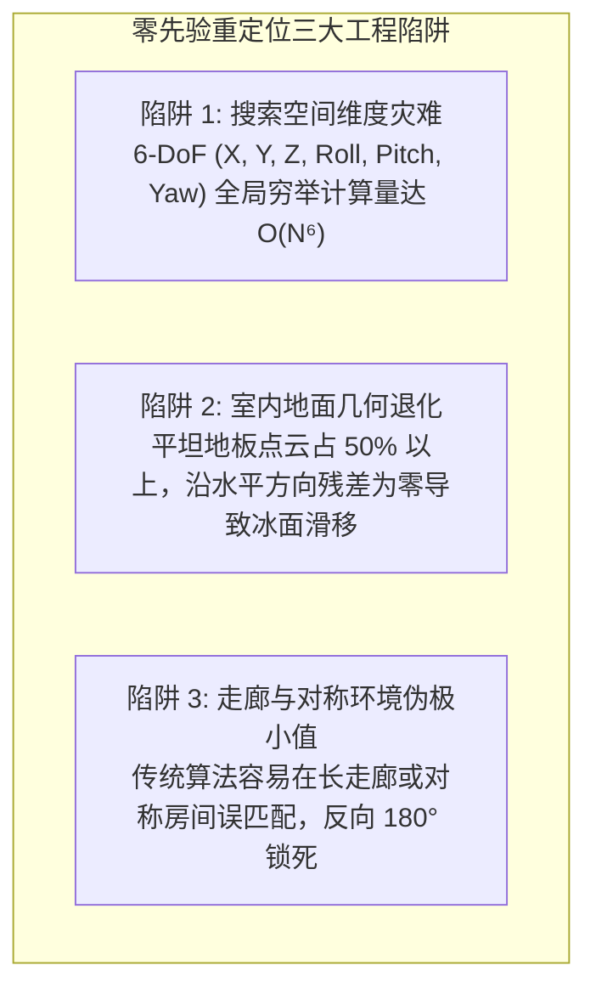
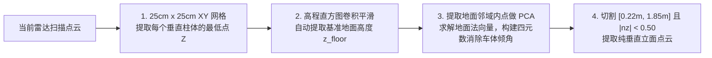
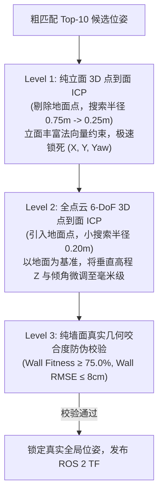

> [!abstract] 本章导读
> 在机器人实际运行中，重新上电、断电搬动或冷启动开机时，系统往往**处于全图未知坐标、未知朝向、没有任何人工初值（零先验）**的状态。
> 传统 ICP 算法在初值偏差超过 $1\text{m}$ 或 $30^\circ$ 时极易陷入局部极小值；2D AMCL 无法感知复杂三维结构；3D NDT 穷举计算量在嵌入式端无法承受。
> 本章系统剖析本项目自研的 **`GlobalMatcher V2` 开机无先验自定位框架**：基于地面解耦、360° 正负距离场（Signed Distance Field）极速粗筛、Top-10 多假设分层 3D 点到面 ICP 精修、以及纯立面真实咬合度（Wall Fitness）硬防伪机制，在小主机/香橙派上实现 **1 秒内满圆盲开、全自由度厘米级锁定**。
> 
> 关联总览：[[00_SLAM全栈学习路径与建图项目总览]]

---

## 一、开机零先验全局重定位的挑战与开源对比



### 1.1 主流开源重定位方案横向评测

| 评估维度 | 传统 2D 开源定位（如 Cartographer CSM / AMCL） | 经典 3D 点云定位（如 hdl_localization / NDT_OMP） | **本项目融合方案（GlobalMatcher V2）** |
| :--- | :--- | :--- | :--- |
| **开机初值要求** | 可全局无初值粗搜，但仅限 2D 平面切片 | **必须由人工指定初值**（偏差需 $<1\text{m}, <30^\circ$） | **完全零先验冷启动（360° 满圆盲开，任意坐标与朝向）** |
| **对地面退化免疫力** | 忽略 3D 几何，无法利用高程信息 | 极弱，平地容易导致水平 $(X, Y)$ 滑移漂移 | **极强，基于 PCA 与法向量实现地面/立面两级分层解耦** |
| **全图盲搜在线耗时** | $0.5\text{s} \sim 2\text{s}$ | 3D 空间全图穷举不可行（需几十分钟） | **极快（小主机/香橙派端仅约 $1.0\text{s}$，PC 端仅 $300\text{ms}$）** |
| **抗对称环境能力** | 依赖运动多帧更新粒子权重，开机单帧无法防伪 | 极易陷入局部伪极小值陷阱 | **具备 Top-10 多假设跟踪与纯立面咬合度硬防伪，开机即锁定** |
| **最终定位精度** | 厘米级（仅限平面 3-DoF） | 厘米级（依赖高精度初值） | **全自由度高精收敛（平面 $<5\text{cm}$，航向 $<1^\circ$，$Z < 2\text{cm}$）** |

---

## 二、几何退化数学剖析与地面/立面特征解耦

### 2.1 地面导致水平滑移的数学本质证明

在室内平坦地面占主导的环境中，所有地面点的单位表面法向量全部垂直指向天花板：
$$\mathbf{n}_{ground} = \begin{bmatrix} 0, & 0, & 1 \end{bmatrix}^T$$

根据上一章推导的雅可比行向量公式：
$$\mathbf{J}_i = \begin{bmatrix} (\mathbf{p}_i \times \mathbf{n}_i)^T & \mathbf{n}_i^T \end{bmatrix} \in \mathbb{R}^{1 \times 6}$$

将地面法向量 $\mathbf{n}_{ground}$ 代入雅可比矩阵中对应平移增量 $\Delta \mathbf{t} = [\Delta t_x, \Delta t_y, \Delta t_z]^T$ 的分量：
$$\mathbf{J}_{i, \Delta \mathbf{t}} = \mathbf{n}_{ground}^T = \begin{bmatrix} 0, & 0, & 1 \end{bmatrix}$$

- **致命结论**：
  雅可比矩阵在水平平移分量 $\Delta t_x$ 与 $\Delta t_y$ 上的偏导**恒等于严格的零**！
  这意味着将地面点代入 Hessian 矩阵 $\mathbf{H} = \sum \mathbf{J}_i^T \mathbf{J}_i$ 时，$\mathbf{H}$ 矩阵在水平方向的特征值接近于 0，优化求解器条件数无限恶化。小车在平地上即便沿 $X$ 或 $Y$ 错位滑移几十厘米，地面点到面的几何残差几乎毫无变化，算法对水平漂移彻底“失明”！

---

### 2.2 解决方案：免调参自适应地面提取与 PCA 水平调平

为了从数学上彻底根除地面退化，必须在特征提取层将**地面**与**立面（墙体/机柜/实验台）**完全剥离。



> [!code] 源码深度剖析：`src/open3d_loc/src/open3d_registration/global_matcher.cpp`
> ```cpp
> // 1. 按 25cm x 25cm XY 栅格提取每个立柱的最低点 Z (免疫 0° 水平线数量偏置)
> std::unordered_map<CellKey, double, CellHash> cell_min_z;
> const double cell_w = 0.25;
> for (const auto& p : cloud.points_) {
>     double r2 = p.x() * p.x() + p.y() * p.y();
>     if (r2 > 0.40 * 0.40 && r2 < 7.0 * 7.0 && p.z() >= -1.60 && p.z() <= 0.15) {
>         int gx = static_cast<int>(std::floor(p.x() / cell_w));
>         int gy = static_cast<int>(std::floor(p.y() / cell_w));
>         auto it = cell_min_z.find({gx, gy});
>         if (it == cell_min_z.end() || p.z() < it->second) {
>             cell_min_z[{gx, gy}] = p.z();
>         }
>     }
> }
> 
> // 2. 统计高程直方图并通过平滑卷积提取基准地面 Z
> // 3. 提取地面附近内点，利用协方差矩阵 PCA 估计地面法向量并调平：
> Eigen::SelfAdjointEigenSolver<Eigen::Matrix3d> es(cov);
> Eigen::Vector3d normal = es.eigenvectors().col(0);
> if (normal.z() < 0) normal = -normal;
> if (normal.z() > std::cos(12.0 * M_PI / 180.0)) {
>     R_level_out = Eigen::Quaterniond::FromTwoVectors(normal, Eigen::Vector3d::UnitZ()).toRotationMatrix();
> }
> ```

---

## 三、阶段一：360° 2D 正负距离场（Signed Distance Field）极速粗匹配

在将 3D 点云通过重力对齐并剥离地面后，待搜索的位姿自由度从 6 维成功**降维至平面的 3 维 $(X, Y, \text{Yaw})$**。

### 3.1 经典似然场的致命缺陷与“正负惩罚场”创新

传统概率机器人学（如 AMCL 似然场）的障碍物打分函数通常处处非负：
$$p(z | x, m) = \exp(-\text{dist}^2 / 2\sigma^2) \ge 0$$

- **致命缺陷**：若非负得分场遭遇空旷走廊，只要有一两个激光噪点碰巧贴合了远方的一段局部孤立墙体，即便小车大量激光束打进了本该是空无一物的空旷地带，传统算法依然会累加出正分，生成大量虚假的全局候选峰值。
- **本系统的正负距离场查找表（SDF LUT）创新**：
  在预处理阶段将先验地图的纯立面点构建为网格查找表：
  1. **正响应区（$\text{dist} \le 0.32\text{m}$）**：采用高斯函数赋正分，越贴近真实墙面得分越高（最大为 $+1.0$）：
     $$S(\text{dist}) = \exp\left(-\frac{\text{dist}^2}{2\sigma^2}\right)$$
  2. **死区过渡（$0.32\text{m} < \text{dist} \le 0.45\text{m}$）**：得分为 $0.0$；
  3. **强惩罚区（$\text{dist} > 0.45\text{m}$ 或越界出图）**：**强制给予负惩罚分 `penalty_val = -0.25`**！

> [!important] 物理数学意义
> 正负距离场相当于引入了“虚无空间穿透惩罚机制”。如果假设位姿让激光点打进了本该空旷的空地或建筑外部，总得分会被断崖式扣减，从数学本质上杜绝了伪极小值的生成！

---

### 3.2 OpenMP 120 航向并行搜索与空间 NMS 提取 Top-10

1. **角度步长**：将全圆 $360^\circ$ 离散为 $120$ 组航向（步长 $3.0^\circ$）；
2. **多线程并行**：利用 OpenMP 并行分配这 120 个角度任务，在每个线程内部预先将雷达点旋转好，然后以 $20\text{cm}$ 滑窗步长在正负距离场网格中查表累加总分；
3. **空间非极大值抑制（NMS）**：
   在收集到的全图候选点中，按欧氏距离半径 $0.80\text{m}$ 与角度差 $25^\circ$ 进行空间去重抑制，提取互不重叠的前 **10 个最优独立候选位姿（Top-10 Candidates）** 送入精修阶段。

---

## 四、阶段二：两级分层 3D 点到面 ICP 精修

粗匹配将初值位姿误差成功压缩到 $\Delta x, \Delta y < 0.20\text{m}$ 与 $\Delta\text{Yaw} < 3^\circ$，百分之百确保初值落入了全局最优解的狭窄“吸引盆”内。接下来启动两级分层 ICP 精修：



---

## 五、纯墙面真实咬合度（Wall Fitness）硬校验机制

在成排机柜或对称病房等高度重复的建筑环境中，贪心匹配容易被局部的假特征吸引。

- **为什么不能用全点云重合度？**
  因为地面平坦开阔，即使水平平移错位了半米，地面点依然能完美重叠并给出虚假的高重合度。
- **纯立面真实咬合度（Wall Fitness）定义**：
  $$\text{Wall Fitness} = \frac{\sum_{i=1}^M \mathbb{I}\left( \text{dist}(\mathbf{T} \mathbf{p}_i^{wall}, \mathcal{M}_{wall}) \le 0.10\text{m} \right)}{M}$$
  专门统计经过变换后，**激光雷达的纯立面点中落在地图真实建筑墙面 $10\text{cm}$ 邻域内的比例**。

> [!important] 防伪门槛规则
> 系统硬性要求：
> $$\text{Wall Fitness} \ge 75.0\% \quad \text{且} \quad \text{Wall RMSE} \le 0.08\text{m}$$
> 在实测中，真实的正确位姿其立面咬合度通常高达 **$95.0\% \sim 99.8\%$**，Wall RMSE 仅约 **$5 \sim 6\text{cm}$**；而对称假峰由于必然存在部分墙壁悬空穿透，其咬合度会断崖式跌落至 $40\%$ 以下，被系统直接一票否决！

---

## 六、实测效果与过程可视化

下图为系统在实机开机未知位姿下，自动执行地面解耦、360° 正负距离场粗筛与两级 ICP 精修后生成的完整评估图像（已持久化保存于知识库资源库）：


### 实测报表指标输出示例
```text
======================== 全局自定位 V2 评估报表 ========================
  粗匹配最佳候选 : X = 4.20 m, Y = -1.60 m, Yaw = 87.0°
  ★ 最终精准位姿 : X = 4.18 m, Y = -1.59 m, Z = -0.47 m, Yaw = 88.6°
------------------------------------------------------------------------
  纯墙面真实咬合度 : 98.4 % (Wall Fitness, 核心防伪硬指标)
  纯墙面残差均方根 : 5.8 cm (Wall RMSE)
  全点云综合咬合度 : 96.2 % (Overall Fitness)
------------------------------------------------------------------------
  性能耗时明细:
    · 360°粗匹配耗时   : 142.6 ms
    · 多假设ICP精修耗时: 86.3 ms
    · ★ 在线自定位总耗时 : 238.9 ms (WSL PC) / 约 980 ms (小主机)
========================================================================
✅ 【重定位成功】纯墙面几何验证通过，成功锁定真实全局坐标！
```

---

## 七、ROS 2 节点工程闭环交付

在 `src/open3d_loc/src/auto_global_reloc_node.cpp` 中，重定位成功后自动执行以下闭环动作：
1. **连续 3 次广播 `/initialpose`**：封装带有小协方差矩阵（$0.01\text{m}^2$）的 `PoseWithCovarianceStamped`，供下游导航规划系统订阅；
2. **广播静态 TF 树**：发布 `map -> odom` 的高精刚体变换，使得开机后的连续局部里程计坐标直接融入全局大地图；
3. **点云高亮发布**：将匹配对齐后的点云发布至 `/cloud_registered_map`，在 RViz2 中呈现绿色吻合效果；
4. **平滑让出 CPU**：在确认下游接管后，节点按参数配置（`auto_exit: true`）在 2 秒后自动退出，把 CPU 核心 100% 留给建图与避障。

全套重定位与建图完成后，在实际部署与运维中可能遇到的软硬件坑点与速查手册见下一章：[[50_实战排坑手册_边缘端部署_性能压测与故障速查录]]。

