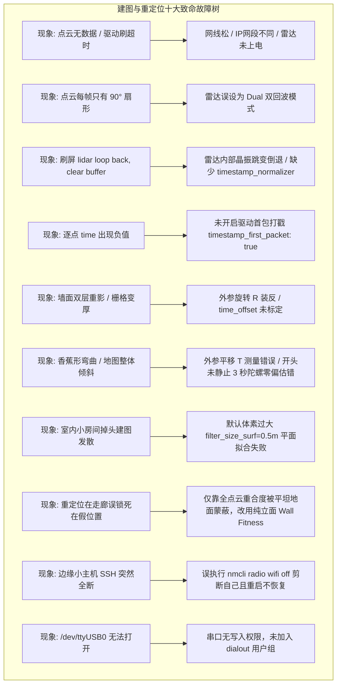
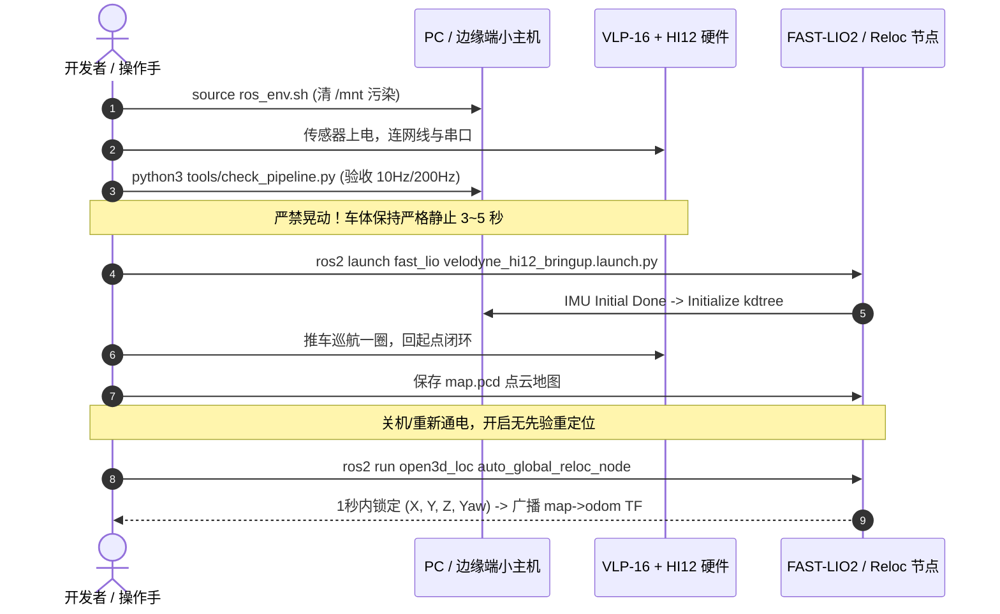

> [!abstract] 本章导读
> 本章是整个建图与重定位项目所有**实操血泪教训、边缘端小主机部署避坑策略与高频致命故障速查矩阵**的集大成之作。
> 无论是在本地 PC 仿真调试，还是将算法移植到实际机器人边缘小主机（`qrssys@192.168.31.111`）上运行时，遇到任何程序报错、建图漂移、时间回退或网络中断，均可直接查阅本手册进行秒级定位与排障。
> 
> 关联总览：[[00_SLAM全栈学习路径与建图项目总览]]

---

## 一、边缘端小主机与 WSL2 协同开发工作流

### 1.1 环境变量隔离脚本：`ros_env.sh` 的救命机制

在 WSL2 与 Windows 双系统环境下，WSL 会默认将 Windows 的 `PATH` 环境变量（如 `/mnt/d/...`）混合继承进 Linux 环境中。这会导致 ROS2 节点在加载动态链接库（`.so`）或调用 Python 脚本时，误加载 Windows 挂载盘上的旧版库或不同架构二进制文件，引发极其诡异的段错误（`Segmentation Fault`）或符号找不到（`undefined symbol`）。

> [!important] 每个新终端的第一件事
> ```bash
> source ~/fast_lio_ws/ros_env.sh
> ```
> `ros_env.sh` 会在第一时间暴力清理所有以 `/mnt/` 开头的污染变量，然后纯净加载 `/opt/ros/humble/setup.bash` 与当前工作区的 `install/setup.bash`，保证编译与运行环境 100% 隔离纯净。

---

### 1.2 局域网雷达与代理（Clash）冲突避坑

在配置激光雷达网络（默认 IP `192.168.1.201`）时，开发机若开启了系统代理（如 Clash / V2Ray 等）：
- **致命现象**：在终端通过 `curl` 访问雷达的 Web 接口（如读取转速与激光状态）时，返回 `502 Bad Gateway` 或连接超时挂起。
- **根因**：HTTP 请求被透明代理劫持，试图通过外网梯子访问内网保留 IP `192.168.1.201`。
- **正确命令**：必须显式添加 `--noproxy '*'` 豁免代理：
  ```bash
  # 读取雷达工作设置 (如确认是不是 Strongest 回波)
  curl --noproxy '*' -s http://192.168.1.201/cgi/settings.json
  # 读取雷达转速与激光发射状态
  curl --noproxy '*' -s http://192.168.1.201/cgi/status.json
  ```

---

## 二、十大经典致命故障速查矩阵



### 故障现象与根因解决方案详细对照表

| 序号 | 故障现象与报错日志 | 根本诱因剖析 | 现场紧急排错处置步骤 |
| :---: | :--- | :--- | :--- |
| **01** | 点云完全没有数据，驱动刷 `Velodyne poll() timeout` | 网线物理松动、雷达电源未插好、或主机网卡未配置为 `192.168.1.x` 同网段 | 1. 终端执行 `ping 192.168.1.201`；<br/>2. 检查本机有线网卡静态 IP 是否设为 `192.168.1.100`；<br/>3. 重启 `velodyne_driver_node`。 |
| **02** | 点云发布频率高达 $20\sim 40\text{Hz}$，但 RViz 里每帧只有 $90^\circ$ 扇形 | 雷达 Web 端被误配为 `Dual`（双回波模式），驱动将数据分片打散 | 访问 `http://192.168.1.201` 将 Return Type 强制改回 **`Strongest`**，并确认 `rpm` 为 600。 |
| **03** | FAST-LIO 终端疯狂刷屏 `lidar loop back, clear buffer` | 没有硬件 PPS 时，雷达内部晶振走时发生向后跳变倒退（实测最大倒退 1.75s） | 启动 `tools/timestamp_normalizer.py` 介入链路，以主机系统时钟逆推并强制 `+1ms` 单调递增锁死。 |
| **04** | 逐点相对时间戳 `time` 出现负数，去畸变导致墙面弯曲更严重 | 驱动配置了尾包打戳，导致点云前半段点的相对时间恒为负值 | 在 `velodyne_driver.yaml` 中设置 `timestamp_first_packet: true`，确保逐点时间在 $[0.0, 0.1]\text{s}$ 内。 |
| **05** | 原地缓慢转圈时，RViz 点云出现**双层墙、重影** | 1. 外参旋转矩阵 $\mathbf{R}$ 轴系定义错误；<br/>2. 雷达与 IMU 存在固定时间偏移 `time_offset_lidar_to_imu` | 1. 运行 `tools/imu_live.py` 根据低头/旋转决策表核对外参；<br/>2. 运行 `tools/scan_time_offset.py` 动态扫描并写入最优偏移值。 |
| **06** | 走直线一圈回到起点时，地图呈**香蕉形弯曲、或者地面倾斜** | 1. 录包或建图开头小车在晃动，导致 FAST-LIO 把运动当成陀螺仪零偏减去；<br/>2. 外参平移 $\mathbf{T}$ 误差过大 | 1. **开机/建图前 3~5 秒严禁触碰机器人**，保证静止初始化成功；<br/>2. 用游标卡尺重新复核雷达到 IMU 的刚体平移。 |
| **07** | 室内小空间掉头时频繁报错 `[diag] NoEffective!` 随后发散 | 默认开源参数是针对室外道路设计的（`filter_size_surf=0.5m`），小房间点云过度稀疏无法拟合平面 | 修改 `config/velodyne.yaml`：`filter_size_surf: 0.2`, `filter_size_map: 0.3`, `point_filter_num: 1`。 |
| **08** | 重定位在长走廊或对称房间锁死在 180° 反向位置 | 传统配准依赖全点云 Fitness，大面积平整地面掩盖了水平错位 | 开启 V2 纯立面真实咬合度（`Wall Fitness ≥ 75%` 且 `Wall RMSE ≤ 8cm`），低于门槛直接一票否决重新采样。 |
| **09** | 边缘小主机（香橙派等）突然 SSH 彻底断开，ping 不通 | 误在终端执行了 `nmcli radio wifi off`，关闭了无线网卡，且该状态会持久化写入磁盘 | **重启小主机也不会恢复！** 必须外接 HDMI 显示器键鼠执行 `sudo nmcli radio wifi on`，或用网线直连网口配静态 IP 登录。 |
| **10** | 启动 IMU 驱动报错 `open port /dev/ttyUSB0 failed: Permission denied` | 当前 Linux 用户不在操作串口硬件的 `dialout` 用户组中 | 执行 `sudo usermod -aG dialout $USER`，然后彻底注销重新登录终端即可永久生效。 |

---

## 三、常用调试与验收脚本工具箱

所有脚本统一存放在 `~/fast_lio_ws/tools/` 目录下，开箱即用：

```bash
# 1. 整机一键全链路吞吐率、帧率与零漂验收检查 (开机必跑)
python3 ~/fast_lio_ws/tools/check_pipeline.py --duration 30

# 2. 单点核验点云内部字段与逐点时间契约 (必须全为正数且在 [0, 0.1] 内)
python3 ~/fast_lio_ws/tools/check_point_time.py

# 3. 实时终端打印 IMU 加速度与欧拉角 (用于外参低头/旋转轴系判定)
python3 ~/fast_lio_ws/tools/imu_live.py 60

# 4. 一键写入外参到 velodyne.yaml
python3 ~/fast_lio_ws/tools/set_extrinsic.py --t 0.0 0.0 -0.0455 --r 1,0,0,0,1,0,0,0,1

# 5. 时间偏移 (time_offset_lidar_to_imu) 自动网格扫描标定
# (先检查动态包运动强度与开头静止)
python3 ~/fast_lio_ws/tools/scan_time_offset.py --bag ~/bags/dyn_run --check-only
# (执行全自动多候选扫描并回写参数)
python3 ~/fast_lio_ws/tools/scan_time_offset.py --bag ~/bags/dyn_run --offsets -0.06 -0.03 0.0 0.03 0.06

# 6. 一键暴力杀掉所有后台 ROS 节点与挂起进程 (防止端口冲突占用)
bash ~/fast_lio_ws/tools/stop_all.sh
```

---

## 四、全流程快速操作卡片（Cheat Sheet）



