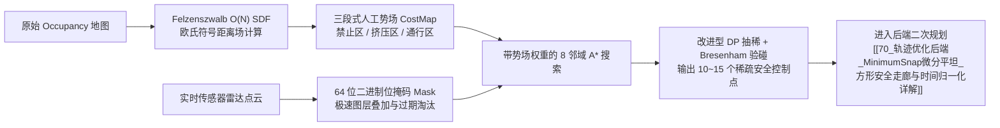

> [!abstract] 本章导读
> 在移动机器人导航与赛场竞速中，“路径能不能走得通”与“路径离障碍物有多远”是前端规划必须同时回答的两个命题。
> 传统的 A\* 算法为了走最短距离，往往贴着障碍物拐角走“贴地飞行”，极易导致底盘擦碰；而直接在前端考虑动力学的 Kinodynamic A\* 搜索空间爆炸，耗时动辄数秒。
> SCU-TDT 采用的 **YAstar（带人工势场的 A\* 算法）** 在保留传统 A\* 毫秒级搜索性能的同时，融合了 **Felzenszwalb 线性时间符号距离场（SDF）**、**三段式人工势场引导**、**64 位位掩码多层动态障碍物（Mask）**，以及**带障碍物碰撞检测的改进型 Douglas-Peucker (DP) 拓扑化简**。
> 本章将用严谨的数学推导与生动的实战算例，带你透彻掌握这一套工业级前端搜索技术。
>
> 关联总纲：[[00_SLAM全栈学习路径与建图项目总览]] · 后续轨迹优化：[[70_轨迹优化后端_MinimumSnap微分平坦_方形安全走廊与时间归一化详解]]

---

## 一、为什么需要人工势场与前端解耦？

### 1.1 经典 A\* 的致命短板：贴墙擦边与锯齿折角

设机器人在一个分辨率为 $0.05\text{ m}$ 的栅格地图中导航，白色为自由栅格（代价为 $1.0$），黑色为障碍物（代价为 $\infty$）。

```
传统 A* 搜索表现（极度贴墙）：
┌────────────────────────────────┐
│             障碍物墙体          │
│ ┌────────────────────────────┐ │
│ │████████████████████████████│ │
│ │████████████████████████████│ │
│ └────────────────────────────┘ │
│ ────────────────────────────── │ <--- 传统 A* 路径直接贴着障碍物外边缘划过（间隙 = 0）
│                                │      实机底盘只要有一丝转向延迟，直接刮蹭撞墙！
└────────────────────────────────┘
```


---

### 1.2 为什么不用 Kinodynamic A\*（K-A\*）硬解全局？

在项目源码 [`kinodynamicAstar.hpp`](file:///home/wgk/decision_planning/SCU-TDT-V1/src/YAstar/kinodynamicAstar.hpp) 中，其实保留了带速度和加速度的动力学 A\* 实现。

| 对比维度 | 纯 Kinodynamic A\* (K-A\*) | SCU-TDT 架构：YAstar + 后端 Minimum Snap |
| :--- | :--- | :--- |
| **状态空间** | 四维连续状态 $\mathbf{s} = [x, y, v_x, v_y]^T$ | 二维离散网格坐标 $(x, y)$ |
| **状态转移** | 枚举加速度 $\mathbf{a}$ 与时间 $\tau$ 积分 $\mathbf{p}(t) = \mathbf{p}_0 + \mathbf{v}_0 t + \frac{1}{2}\mathbf{a}t^2$ | 8 邻域栅格移动（步长 $1.0$ 或 $\sqrt{2}$） |
| **搜索耗时** | 全局搜索一次耗时 **$1.5 \sim 2.5\text{ 秒}$** | 前端搜索 **$3 \sim 8\text{ ms}$** + 后端优化 **$5 \sim 15\text{ ms}$** |
| **动力学质量** | 受限于加速度离散采样，轨迹可能呈现分段多项式折线 | 高阶分段多项式，高阶导数（Jerk/Snap）全局最优且严格连续 |
| **工程哲学** | 试图让图搜索干优化的事（搜索空间维度灾难） | **前端管“能不能到与避障”，后端管“如何优雅快速地到”** |

---

## 二、欧氏符号距离场（SDF）：Felzenszwalb 线性时间算法

为了给全图每个栅格赋予人工势场，首先必须知道：**每个栅格距离最近的障碍物到底有多少米？**
若用暴力方法，全图 $N = W \times H$ 个栅格，每个栅格遍历搜索 $M$ 个障碍物点，计算复杂度高达 $\mathcal{O}(N \times M)$。在 $600 \times 300$ 的地图上，暴力法需要计算数亿次距离，系统直接卡死。

`YAstar` 在 [`yastar.cpp:577-744`](file:///home/wgk/decision_planning/SCU-TDT-V1/src/YAstar/yastar.cpp#L577-L744) 中手写实现了计算机视觉领域的经典算法：**Felzenszwalb & Huttenlocher (2012) 线性时间欧氏距离变换**，仅需两次一维扫描，以严格 $\mathcal{O}(W \times H)$ 复杂度（**实测 3 毫秒**）算大全图距离！

### 2.1 距离变换的一维数学建模：抛物线下包络

设一维网格上有 $n$ 个离散位置 $q \in \{0, 1, \dots, n-1\}$，输入信号为 $f(q)$（若 $q$ 是障碍物则 $f(q) = 0$，若是自由空间则 $f(q) = \infty$）。
一维平方欧氏距离变换定义为：
$$\mathcal{D}(p) = \min_{q} \left( (p - q)^2 + f(q) \right)$$

从几何上看，每一个已知的障碍物点 $q$，都在空间中定义了一条以 $(q, f(q))$ 为顶点的**垂直开口向上的抛物线** $g_q(p) = (p - q)^2 + f(q)$。
所有障碍物点的抛物线在上方交织，而我们要求解的 $\mathcal{D}(p)$，恰恰就是**这一簇抛物线的下包络线（Lower Envelope）**！

```
一维抛物线下包络线几何示意：
代价 D(p)
  ^
  │        \       /             \       /
  │         \     /               \     /
  │          \   /                 \   /
  │           \ /                   \ /
  │  ──────────●─────────────────────●────────── 下包络线（取所有抛物线的最低点）
  │           q=2                   q=8
  └──────────────────────────────────────────────> 网格坐标 p
```

#### 两条抛物线的交点解析公式
设两条抛物线的顶点分别位于 $s$ 和 $q$（且 $s < q$），求它们的水平交点坐标 $x$：
$$(x - s)^2 + f(s) = (x - q)^2 + f(q)$$
展开移项：
$$x^2 - 2sx + s^2 + f(s) = x^2 - 2qx + q^2 + f(q)$$
$$2(q - s)x = (f(q) + q^2) - (f(s) + s^2)$$
$$x = \frac{(f(q) + q^2) - (f(s) + s^2)}{2(q - s)}$$

> [!code] 源码严格对应（`yastar.cpp:615`）
> ```cpp
> intersect = (f_q + static_cast<float>(q*q) - f_s - static_cast<float>(s*s)) / (2.0f * static_cast<float>(q - s));
> ```

---

### 2.2 二维距离变换的可分离性（Separability）

二维欧氏距离的平方具有美妙的可分离性质：
$$\mathcal{D}(x, y) = \min_{x', y'} \left( (x - x')^2 + (y - y')^2 + f(x', y') \right) = \min_{x'} \left( (x - x')^2 + \min_{y'} \left( (y - y')^2 + f(x', y') \right) \right)$$

这意味着二维距离场可以通过两步一维扫描完美解耦：
1. **第一步（按列扫描）**：对地图的每一列分别运行一维距离变换，计算垂直方向的最近距离；
2. **第二步（按行扫描）**：在第一步输出的基础上，对每一行分别运行一维距离变换，计算水平方向的最近距离；
3. **第三步（开方与物理尺度缩放）**：
   $$\text{SDF}(x, y) = \sqrt{\mathcal{D}(x, y)} \times \text{mapping}$$
   其中 $\text{mapping}$ 是地图分辨率（如 $0.05\text{ m}$）。

> [!example] 数值算例
> 设地图网格分辨率为 $0.05\text{ m}$。若某个栅格计算得到的平方距离为 $\mathcal{D} = 100$（格子的平方），则其实际物理欧氏距离为：
> $$\text{dist} = \sqrt{100} \times 0.05\text{ m} = 10 \times 0.05\text{ m} = 0.50\text{ m}$$
> 机器人在任意位置，只需 $O(1)$ 查表即可瞬间获知自己离最近障碍物精确相距 $0.50\text{ m}$！

---

## 三、三段式人工势场代价函数设计

有了全图的欧氏距离 $\text{dist} = \text{SDF}(x, y)$ 后，如何设计代价函数引导 A\* 规划？

在 [`scu_recovery_tracker.hpp:80-85`](file:///home/wgk/decision_planning/SCU-TDT-V1/include/scu_tdt_v1/scu_recovery_tracker.hpp#L80-L85) 中，SCU-TDT 创新性地设计了**三段式区域代价场**，严格对标工业级自动驾驶与 Nav2 的“禁止区 / 挤压区 / 通行区”分层哲学：

$$\text{Cost}(d) = \begin{cases}
500.0, & 0 \le d \le 0.22\text{ m} \quad (\text{禁止区}) \\
28.0 \times \left(\dfrac{0.50 - d}{0.50 - 0.22}\right)^2 + \dfrac{0.20}{d + 0.10}, & 0.22\text{ m} < d \le 0.50\text{ m} \quad (\text{挤压区}) \\
\dfrac{0.20}{d + 0.10}, & d > 0.50\text{ m} \quad (\text{通行区})
\end{cases}$$

```
三段式代价场曲线示意图：
代价 Cost
  ^
  │  500 [禁止区: 绝对物理死刑区，严禁底盘半径侵入]
  │  │
  │  │
 30  │     \
  │  │      \   [挤压区: 二次平滑排斥势场，将路径推离墙体]
 15  │       \
  │  │        \
  1  │         ───────────── [通行区: 微弱中轴线引导，宽阔地带自动居中]
  0  └─────┬──────────────┬──────────────> 距离 d (米)
          0.22m          0.50m
      (车体半径)      (安全舒适裕度)
```

### 3.1 三段势场的物理含义与调参法则

1. **禁止区（$d \le 0.22\text{ m}$，对应 `robot_radius` 底盘半径）**：
   - 机器人的几何外轮廓半径是 $0.22\text{ m}$。若底盘中心距离障碍物小于 $0.22\text{ m}$，机器人物理上必定已经撞墙！
   - 此处赋以极高惩罚 $500.0$。在 A\* 搜索中，除非终点就设在墙里，否则算法绝不会踏入半步。
2. **挤压区（$0.22\text{ m} < d \le 0.50\text{ m}$）**：
   - 当小车通过狭窄通道或门洞时，往往无法保持大间隙。
   - 采用二次函数平滑过渡：当 $d = 0.50\text{ m}$ 时排斥代价为 $0$；当 $d \to 0.22\text{ m}$ 时排斥代价平方递增至 $28.0$。连续的二次势场保证了代价梯度的平滑性，避免算法在狭窄通道内剧烈振荡。
3. **通行区（$d > 0.50\text{ m}$）**：
   - 附加一个反比例衰减项 $\frac{0.20}{d + 0.10}$。当走廊宽度很大（如 $2\text{ m}$）时，走廊中心线的距离 $d \approx 1.0\text{ m}$，代价约为 $0.18$；而靠近墙壁处 $d \approx 0.55\text{ m}$，代价约为 $0.31$。A\* 算法为了让总代价最小，会自动在走廊居中行驶。

---

## 四、64 位位运算多层动态掩码（Bitmask Mask）

在 Robocon 或 RoboMaster 等动态对抗赛场中，随时有敌方机器人切入、临时障碍物放置或实时激光雷达探测到移动物体。

### 4.1 传统动态障碍物维护的内存陷阱

若每次激光雷达探测到障碍物，都在一张全图大小的二维浮点矩阵上进行拷贝或重绘：
- 一张 $600 \times 300$ 的浮点矩阵占约 $720\text{ KB}$ 内存；
- 每秒 20 帧雷达点云，频繁的内存动态分配与缓存失效（Cache Miss）会导致 CPU 负载飙升，实时规划出现卡顿掉帧。

---

### 4.2 `Mask` 类的位运算黑科技

SCU-TDT 在 [`yastar.hpp:23-51`](file:///home/wgk/decision_planning/SCU-TDT-V1/src/YAstar/yastar.hpp#L23-L51) 中设计了位运算优化的 `Mask` 类：
每个栅格位置不存储多个浮点数，而是用一个 **64 位无符号整数（`unsigned long long int`，占用 8 字节）** 的每一个二进制位（Bit），分别代表一层独立的掩码！

```
单个像素位置的 64 位二进制存储结构：
Bit 63                                              Bit 2        Bit 1        Bit 0
┌──────────────────────────────────────────────────┬────────────┬────────────┬────────────┐
│ ... (可扩展图层)                                  │ 临时禁行区 │ 动态障碍物 │ 静态激光层 │
└──────────────────────────────────────────────────┴────────────┴────────────┴────────────┘
```

#### ① 添加/更新某一层掩码（`pushMask`）
设要将图层编号为 `curlayer`（例如第 1 层：实时雷达层）中处于障碍物位置的栅格置为不可通行：
1. 计算该图层对应的掩码选择子：
   $$\text{bitChooser} = 1\text{ULL} \ll (\text{curlayer} \% 64)$$
2. 若当前位置为障碍物，按位或（OR）写入：
   $$\text{tgt} \;\vert= \text{bitChooser}$$
3. 若非障碍物，按位与非（AND NOT）清除：
   $$\text{tgt} \;\&= \sim\text{bitChooser}$$

#### ② $O(1)$ 极速碰撞查询（[`masked(x, y)`](file:///home/wgk/decision_planning/SCU-TDT-V1/src/YAstar/yastar.hpp#L60-L67)）
要判断某个栅格是否被任何一层掩码阻挡，**只需检查该 64 位整数是否非零**：
```cpp
bool Mask::masked(int x, int y) const {
    int base = (y * mask.shape[1] + x) * mask.shape[2];
    bool op = false;
    for(int a = 0; a < mask.shape[2]; a++){
        op |= (mask.data[base + a]); // 一条 CPU 位运算指令，瞬间同时核验 64 个图层！
    }
    return op;
}
```

#### ③ 带时间有效期的动态滑动窗口（[`setMaskMapTimed`](file:///home/wgk/decision_planning/SCU-TDT-V1/src/YAstar/yastar.cpp#L451-L506)）
为每一层动态障碍物记录写入时刻 `layerTimes[i]`：
当距离上次更新的时间差 `duration > 1.0` 秒时，系统自动判定该动态障碍物已移走或失效，复用该 bit 位并将其清零，实现了零内存碎片的动态滑动感知。

---

## 五、几何路径化简：改进型 Douglas-Peucker 与 Bresenham 视线拉直

A\* 搜索完成后，输出的是一条沿着 8 邻域栅格逐步推进的稠密折线（可能包含数百个离散栅格点，带有严重的走楼梯锯齿）。如果直接交给后端 Minimum Snap，会导致优化变量过多、拟合锯齿振荡。

### 5.1 Bresenham 整数光栅化射线求交（`lineInObsticle`）

要化简路径，必须能够极速判断：**在空间两点 $P_1(x_1, y_1)$ 和 $P_2(x_2, y_2)$ 之间拉一条笔直的视线，中间是否会穿过障碍物？**

[`yastar.cpp:151-183`](file:///home/wgk/decision_planning/SCU-TDT-V1/src/YAstar/yastar.cpp#L151-L183) 实现了著名的 **Bresenham 直线光栅化算法**：
- 全程只用整数加减法与位移运算，完全不产生浮点除法；
- 维护误差项 $err = \Delta x - \Delta y$；
- 当误差积累超过阈值时步进一个栅格，严格沿连线经过的每一个像素进行 `isInObstacle(x, y)` 碰撞检查。

---

### 5.2 障碍物感知的改进型 Douglas-Peucker (DP) 抽稀算法

经典 DP 算法用于折线抽稀，其逻辑是：连接折线首尾，计算中间所有点到首尾连线的垂直几何距离，若最大距离小于阈值，则将中间点全部剔除。

> [!warning] 经典 DP 算法在机器人避障中的致命缺陷
> 如果一堵凸出墙体挡在首尾两点之间，但该墙体凸出的高度刚好略小于抽稀阈值（例如凸出 $0.07\text{ m} < 0.10\text{ m}$），经典 DP 算法会粗暴地把中间所有路径点删掉，直接将首尾拉一条直线——**结果就是规划出来的化简折线直接穿透障碍物撞墙！**

```
经典 DP 的穿墙 Bug 与 SCU-TDT 改进对比：
             ▲ 凸出的墙角
            ███
  起点 P0 ───███────────── 终点 P1  <--- 经典 DP 认为中间点离直线很近，强行拉直穿墙！
              │
              └─ SCU-TDT 改进：判断 lineInObsticle(P0, P1) 为真，
                 强制保留拐角顶点作为必经控制点，绝对不穿墙！
```

#### SCU-TDT 的改进核心代码（[`yastar.cpp:209-222`](file:///home/wgk/decision_planning/SCU-TDT-V1/src/YAstar/yastar.cpp#L209-L222)）
```cpp
bool isInObstacle = lineInObsticle(path[index0], path[index1]);
// ... 计算中间点到首尾连线的最大欧氏距离 maxDistance ...

// ★ 核心改进：只要最大距离超过阈值，或者直连线段发生了碰撞，就强制递归拆分！
if (maxDistance > threshold || isInObstacle) {
    auto path0 = this->simplifyPathDP(path, index0, maxIndex, threshold);
    auto path1 = this->simplifyPathDP(path, maxIndex, index1, threshold);
    // 合并两段递归结果
} else {
    // 只有在距离极小 且 纯直线绝对安全时，才允许拉直！
    return {path[index0], path[index1]};
}
```

经过改进型 DP 抽稀后，原先几百个栅格点的冗余路径被精简为 **10 ~ 15 个关键拐角路标点**，且 100% 保证线段拓扑连通、安全无碰撞。这几个关键路标点，接下来将作为后端二次规划（Minimum Snap）的输入边界条件！

---

## 六、本章小结与系统演进



在前端成功交出一条既远离障碍物、又去除冗余折角的高质量路标点后，下一章我们将深入机器人动力学核心：利用**微分平坦性**、**方形安全走廊（SFC）**与**时间归一化 OSQP 求解器**，将这些折线点打磨成电机可直接执行的高阶平滑轨迹！
