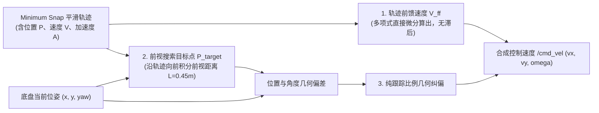
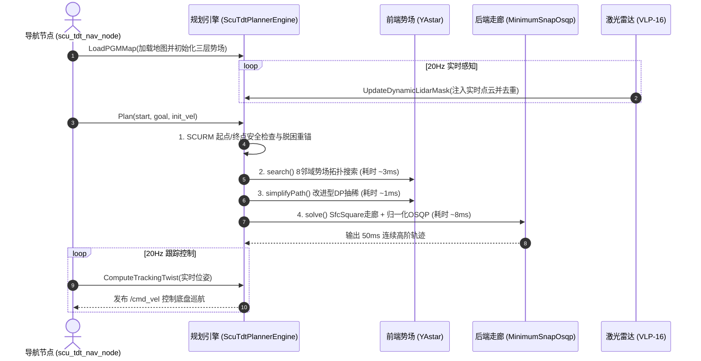
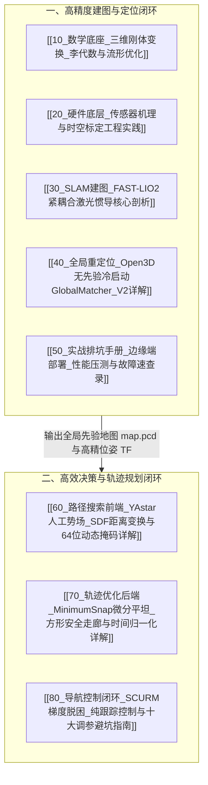

> [!abstract] 本章导读
> 在真实的移动机器人比赛或自主作业中，即便算法在数学上算出了极其优美的轨迹，一旦遇到底盘轮子打滑、推挤碰撞、障碍物膨胀区卡死等工程现实，系统就可能瘫痪。
> 本章聚焦从“轨迹多项式”到“电机轮速指令”的**控制闭环与故障自愈机制**。系统剖析 SCU-TDT 的 **SCURM 自由空间梯度脱困算法**、**轨迹前馈 + 纯跟踪（Pure Pursuit）复合控制器**、**全向与差速底盘适配**，并提炼出 **10 大实战调参避坑指南**。
>
> 关联总纲：[[00_SLAM全栈学习路径与建图项目总览]] · 前端搜索：[[60_路径搜索前端_YAstar人工势场_SDF距离变换与64位动态掩码详解]] · 后端优化：[[70_轨迹优化后端_MinimumSnap微分平坦_方形安全走廊与时间归一化详解]]

---

## 一、SCURM 风格自由空间智能脱困（SmartFreeSpaceRecovery）

### 1.1 机器人为什么会“被卡死”？常见死锁场景

在移动机器人实战中，常常出现以下尴尬场景：
1. **急停刹车超调**：小车高速冲向障碍物前紧急制动，由于惯性或摩擦力不足，车头恰好扎进了膨胀层（进入了禁止区，离障碍物仅 $0.15\text{ m}$）；
2. **外力推搡或挤压**：在对抗比赛中被其他机器人顶到了墙角；
3. **开机自定位位置偏置**：开机重定位后，当前估计坐标恰好落在某张桌子或矮障碍物的膨胀掩码内。

> [!warning] 经典全局规划器的“死机死循环”
> 此时若直接调用 A\* 或任何基于代价图的全局搜索算法，算法读取起点位置的代价值发现是 $\infty$（禁止区），会立即抛出错误：`Error: start point in obstacle! return start point only`。规划器直接放弃计算，机器人停在原地动弹不得，发生永久死锁！

---

### 1.2 朝向安全自由空间的梯度搜索（`FindNearestSafePoint`）

SCU-TDT 在 [`scu_recovery_tracker.hpp:170-208`](file:///home/wgk/decision_planning/SCU-TDT-V1/include/scu_tdt_v1/scu_recovery_tracker.hpp#L170-L208) 中设计了自动脱困重锚点机制：

```mermaid
flowchart TD
    Current["当前机器人坐标 (卡在墙角/膨胀区内)"] --> Check{"检查当前点安全性<br/>pointInObsticle 或 SDF < safe_clearance"}
    Check -->|安全| Pass["直接作为规划起点"]
    Check -->|不安全 (已卡死)| Search["360° 扇形向外搜索自由空间<br/>半径 r ∈ [0.10m, 1.20m], 36 个离散航向"]
    Search --> Filter["剔除仍在障碍物内的候选点"]
    Filter --> Score["综合评估得分:<br/>Score = SDF(clearance) - 0.35 * r"]
    Score --> Pick["挑出空间最开阔、离车最近的安全锚点<br/>将规划起点自动矫正到此！"]
```

#### 锚点评分公式与物理权衡
对于搜索到的任意候选点，计算其安全评分：
$$\text{Score} = \text{SDF}(\text{cand}) - 0.35 \times r$$
- $\text{SDF}(\text{cand})$：该点到周围障碍物的最小欧氏距离（安全裕度，值越大越开阔）；
- $r$：该点距离小车当前位置的距离（移动成本）；
- **权衡物理意义**：算法不仅要找开阔的地方，还要尽量少移动。不会为了追求极致的开阔而让小车大费周折倒退几米，而是**在离车最近的半米范围内，迅速找到能容纳底盘的安全开阔地带**！

---

### 1.3 智能脱困速度指令输出（`ComputeSmartRecoveryTwist`）

一旦触发脱困模式，系统不再发送全速追踪指令，而是切换为平稳的脱困速度（$0.35\text{ m/s}$）：
1. 计算逃逸方向矢量：$\mathbf{d} = \frac{\mathbf{p}_{\text{safe}} - \mathbf{p}_{\text{robot}}}{\|\mathbf{p}_{\text{safe}} - \mathbf{p}_{\text{robot}}\|}$；
2. 转换到车体机体坐标系（`base_link`）：
   $$\begin{bmatrix} v_{x,\text{body}} \\ v_{y,\text{body}} \end{bmatrix} = \begin{bmatrix} \cos\theta & \sin\theta \\ -\sin\theta & \cos\theta \end{bmatrix} \begin{bmatrix} d_x \\ d_y \end{bmatrix}$$
3. **底盘运动学解耦适配**：
   - **全向底盘（麦轮/全向轮）**：小车机身可以不转，直接沿合力方向横向/斜向平移脱困；
   - **差速底盘（两轮差速/四轮差速）**：
     - 若安全开阔区在小车后方（$v_{x,\text{body}} < 0$），**直接倒车（$v_{\text{lin}} = -0.35\text{ m/s}$）**脱离死角；
     - 同时根据侧向偏差计算角速度 $\omega = 1.2 \times \text{atan2}(v_y, |v_x| + 0.1)$，边退边把车头转向开阔地带。

---

## 二、轨迹前馈 + 纯跟踪（Pure Pursuit）复合控制器

### 2.1 为什么纯反馈控制在高速下会滞后甩尾？

在经典 ROS 导航中，很多控制器只使用位置误差反馈：
$$v = K_p (p_{\text{target}} - p_{\text{curr}})$$
- 当小车速度提高到 $1.5\text{ m/s}$ 以上时，反馈控制器必须先产生一段位置偏差，才会计算出转向和加速指令。
- 在急转弯时，这种“滞后性”会导致小车在弯道外侧严重偏离轨迹，发生切弯迟钝和甩尾。

---

### 2.2 前馈 + 纯跟踪复合控制原理

SCU-TDT 在 [`scu_recovery_tracker.hpp:376-455`](file:///home/wgk/decision_planning/SCU-TDT-V1/include/scu_tdt_v1/scu_recovery_tracker.hpp#L376-L455) 中构建了**前馈（Feedforward）+ 纯跟踪（Pure Pursuit）复合控制**：



> [!example] 老司机视线前瞻的比喻
> - **前馈速度 $\mathbf{v}_{\text{ff}}$**：就是多项式给出的“理想速度”。如果你完全在轨迹上，只要给这个速度，车子就能沿着轨迹跑；
> - **前视目标点（Lookahead Point）**：人的眼睛不会只盯着自己脚底下的轮子，而是会盯着前方 $0.45\text{ m}$ 的路面（预判前方弯道）；
> - **曲率转向公式（纯跟踪核心）**：
>   根据阿克曼/差速几何学，设前视点在车体坐标系下的横向偏差为 $e_y$，前视距离为 $L$，则期望曲率半径 $R$ 满足 $2 R e_y = L^2$。对应的转向角速度为：
>   $$\omega = \frac{2 v_x}{L^2} e_y$$
>   横向偏差越大，转向打得越急；车速越快，转向越平顺！

---

## 三、`ScuTdtPlannerEngine` 端到端流水线全景

在 [`scu_recovery_tracker.hpp`](file:///home/wgk/decision_planning/SCU-TDT-V1/include/scu_tdt_v1/scu_recovery_tracker.hpp) 中，整个导航规划引擎被封装为极简的流水线调用：



---

## 四、十大实战调参避坑指南（源码级速查宝典）

在实际比赛调车与代码二开中，以下 10 个细节是无数次炸机与撞墙换来的血泪经验：

### ⚠️ 避坑 01：`setCollisionCheckIter` 必须 $\ge 1$！设为 0 会直接返回空轨迹！
- **现象**：调用 `min_snap_.solve(input)`，返回的 `result.success` 始终为 `false`，轨迹点数为 0。
- **根因**：在 [`minimumSnap.cpp:125`](file:///home/wgk/decision_planning/SCU-TDT-V1/src/MinimumSnapOsqp/minimumSnap.cpp#L125) 中：
  ```cpp
  for(int round = 0; round < maxIter; round++) { ... }
  ```
  如果传入 `maxIter = 0`，主求解循环一次都不执行直接退出！
- **正确做法**：**至少设置 `input.setCollisionCheckIter(1)`**（代表求解 1 次；若需碰撞检测重修可设为 `3 ~ 5`）。

---

### ⚠️ 避坑 02：多项式系数内部是“升幂”，返回前被 `unpack` 转成了“降幂”！
- **底层细节**：
  - 在 `generateQ` 和 `generateA` 中，多项式系数按**升幂**排列：$p(t) = a_0 + a_1 t + a_2 t^2 + \dots$；
  - 但在求解完成后，代码内部调用了 [`unpack`](file:///home/wgk/decision_planning/SCU-TDT-V1/src/MinimumSnapOsqp/minimumSnap.cpp#L50-L60)，将矩阵翻转为**降幂**：$[a_{N-1}, a_{N-2}, \dots, a_0]$，以便直接使用秦九韶/霍纳法则（Horner's Method）求值。
- **排错提醒**：如果你自己手写轨迹求导函数，切记系数矩阵最高次项在第 0 列！

---

### ⚠️ 避坑 03：长直走廊必须做中轴线重采样，防止高阶多项式龙格甩尾撞墙！
- **现象**：在长走廊尽头拐弯时，小车还没走到拐角，在直道末端就突然向外侧墙壁猛甩一下，导致撞墙。
- **根因**：DP 抽稀把 6 米直道压缩成仅首尾 2 个点（该段时长可能分配了 $5.0\text{ s}$，而转弯段只有 $0.4\text{ s}$）。为了保持 1~3 阶导数连续，长分段在末端会产生剧烈的反向过冲（龙格现象）。
- **正确做法**：如 [`scu_recovery_tracker.hpp:293`](file:///home/wgk/decision_planning/SCU-TDT-V1/include/scu_tdt_v1/scu_recovery_tracker.hpp#L293) 所示，对前端路径**每隔固定步长（如 $0.7\text{ m} \sim 0.85\text{ m}$）保留一个控制点**，让时间跨度均匀分布，彻底消除甩尾。

---

### ⚠️ 避坑 04：必须开启时间归一化 `input.setNormTime(true)`！
- **底层细节**：未开启归一化时，高次项 $t^5$ 会让 $\mathbf{Q}$ 矩阵对角元素相差数百万倍，OSQP 求解器极易报数值崩溃（`Status = -2`）。开启归一化后，多项式底数严格限制在 $[0, 1]$，收敛率高达 100%。

---

### ⚠️ 避坑 05：更新动态掩码后，必须显式调用 `astar.initCostMap(true)`！
- **底层细节**：`YAstar::search()` 在寻路结束时会自动重置 `nodeMap`，但**不会自动重置 `costMap`**！如果通过 `setMaskMap()` 传入了新的动态障碍物，必须显式调用一次 `astar.initCostMap(true)`，否则搜索依然沿用旧的代价场！

---

### ⚠️ 避坑 06：实时激光雷达点云注入时，必须剔除“已知静态墙面”！
- **底层细节**：VLP-16 雷达扫到的点 90% 都是静态墙。如果把所有点都作为动态障碍物做膨胀，走廊实际可通过宽度会被无端压缩 $10 \sim 20\text{ cm}$。
- **解决办法**：在注入前先检查点落点周围 $2 \times 2$ 栅格是否已是静态黑格（`raw_map_ == 0`），是则跳过（见 [`scu_recovery_tracker.hpp:138-148`](file:///home/wgk/decision_planning/SCU-TDT-V1/include/scu_tdt_v1/scu_recovery_tracker.hpp#L138-L148)）。

---

### ⚠️ 避坑 07：Eigen 矩阵下标顺序是 `(y, x)`（行主序），切勿写反！
- **底层细节**：`YAstar::TMatrix` 和 `SfcSquare::Map` 均显式声明了 `Eigen::RowMajor`（行主序）。在访问像素值时，**第一个下标是行索引 `y`，第二个是列索引 `x`**，即 `map(y, x)`！写成 `map(x, y)` 会发生转置错位或内存越界段错误。

---

### ⚠️ 避坑 08：世界坐标系原点负偏置与内部非负坐标转换
- **底层细节**：ROS 地图原点通常为负值（例如 `origin: [-7.5, -2.5]`）。`SfcSquare` 内部寻址使用的是正网格下标。最稳妥的方式是在外部通过 `WorldToLocal` 将坐标平移为非负局部系 $[0, W \cdot \text{res}] \times [0, H \cdot \text{res}]$，算法运行完毕后再通过 `LocalToWorld` 转回世界坐标。

---

### ⚠️ 避坑 09：`lineInObsticle` 的碰撞容忍度选择
- **底层细节**：`MinimumSnap::lineInObsticle` 默认包含 `obstacleTolerance = 2` 的容忍机制（允许线段擦过 2 个边缘像素而不触发重构，防止由于走廊紧贴墙壁导致的死循环）。若在梅花桩等高危离散地形，可通过 `setStrictCollision(true)` 开启单像素零容忍。

---

### ⚠️ 避坑 10：OSQP 求解失败时的优雅降级（Fallback）
- **底层细节**：在极端狭窄的 S 弯道，由于多段连续性耦合，OSQP 偶尔可能达到迭代上限。工业级系统绝不能原地死机：
  ```cpp
  if (!ms_res.success) {
      // 1. 降级为零空间闭式求解
      input.setBackend(MinimumSnap::Backend::Close);
      ms_res = min_snap_.solve(input);
  }
  if (!ms_res.success) {
      // 2. 最终兜底：直接输出前端化简后的折线，确保机器人持续前行！
      out.smooth_traj_w = out.raw_astar_path_w;
  }
  ```

---

## 五、导航全栈技术总结与未来展望

至此，我们已经完成了从 **SLAM 激光建图与全局重定位**，到 **前端势场拓扑搜索**，再到 **后端高阶走廊轨迹优化与闭环控制** 的全流程解析：




