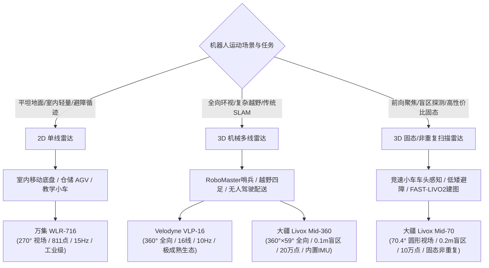
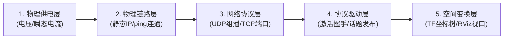

> [!abstract] 系列导读
> 在移动机器人、自动驾驶和竞速底盘工程中，**激光雷达（LiDAR）** 是赋予机器人高精度环境感知与低漂移定位能力的核心“眼睛”。
> 本系列《Radar档案》旨在摒弃晦涩的泛泛而谈，以**“开箱即用、直面实战”**的视角，记录作者在实际机器人开发中所使用过的各类激光雷达，详细拆解其**物理机理、核心参数、驱动配置、落地效果、优缺点对比**，以及最宝贵的**实操踩坑与解决方案**。
> 
> 无论你是第一次接触雷达的初学者，还是正在为机器人选型的算法工程师，本手册都能为你提供一份清晰的实践指引。
> 
> 🔗 **全栈知识体系关联**：[[00_SLAM全栈学习路径与建图项目总览]]（三维建图、时空标定、全局重定位与决策规划总纲）

---

## 一、激光雷达技术路线与全维度选型矩阵

在机器人感知领域，激光雷达主要分为 **2D 单线雷达** 与 **3D 多线/固态雷达** 两个主要大类。选型的核心不是“越贵越好”，而是**传感器维度与底盘任务的严格匹配**。



### 1.1 核心维度量化对比

| 评估指标 | 2D 单线激光雷达 (如 WLR-716) | 3D 机械多线激光雷达 (如 VLP-16) | 3D 前向固态雷达 (如 Livox Mid-70) | 3D 全向混合固态雷达 (如 Livox Mid-360) |
| :--- | :--- | :--- | :--- | :--- |
| **空间维度** | 单一水平横切面（2D 平面切片） | 空间立体包络（3D 空间点云体素） | 空间立体包络（花瓣状非重复扫描点云） | 空间半球包络（全向非重复扫描 + 内置 IMU） |
| **自由度约束** | 仅约束 3-DOF：$X, Y, \text{Yaw}$ | 约束完整 6-DOF：$X, Y, Z, \text{Roll}, \text{Pitch}, \text{Yaw}$ | 约束完整 6-DOF：$X, Y, Z, \text{Roll}, \text{Pitch}, \text{Yaw}$ | 约束完整 6-DOF（自带 200Hz IMU 单线即建图） |
| **视场覆盖** | 扇形（典型 $270^\circ \sim 360^\circ$） | 水平 $360^\circ$ 全向，垂直有夹角（如 $\pm 15^\circ$） | 前向圆形锥体 $70.4^\circ$（随时间积分覆盖率逼近 $100\%$） | **水平 $360^\circ$ 全向，垂直 $-7^\circ \sim +52^\circ$（$59^\circ$）** |
| **近距盲区** | 典型 $0.05\text{ m} \sim 0.1\text{ m}$ | 约 $0.4\text{ m} \sim 0.5\text{ m}$ | 约 $0.2\text{ m}$ | **低至 $0.1\text{ m}$（$10\text{ cm}$）** |
| **算力负载** | **极低**（单核 CPU 占用通常 $< 10\%$） | **中到高**（需要配套 KD-Tree/IEKF 滤波算法） | **中等**（结合 ikd-Tree 与逐点去畸变极速计算） | **中到高**（$20\text{ 万点/秒}$，精细体素需降采样调优） |
| **抗颠簸能力** | **较弱**（车体颠簸时光斑切片扫地变假障碍） | **极强**（地面与垂直结构分明，易于拟合） | **极强**（固态无旋转机芯，耐剧烈振动） | **极强**（$265\text{ g}$ 一体封装无滑环，IP67） |
| **数据通信** | 常见为 100M 以太网 TCP/UDP 或串口 | 100M 以太网 UDP 组播/广播 | 100M 以太网 UDP（Livox-SDK / CustomMsg） | 100M 以太网 UDP（Livox-SDK2；Agras 版用 60000/60001/60003） |
| **典型应用算法** | Cartographer 2D, Gmapping, AMCL, Nav2 | FAST-LIO2, LIO-SAM, Point-LIO, LOAM | FAST-LIO2, FAST-LIVO2, Point-LIO | FAST-LIO2, FAST-LIVO2, Point-LIO, 高精楼梯高程图 |

---

## 二、初学者通用排查心法：激光雷达“五步点穴法”

拿到任何一款新激光雷达，如果在上位机或 RViz 中看不到点云，**切忌盲目卸载驱动或重装系统**。按照计算机系统分层模型，从物理层自底向上逐层排查，99% 的问题都能在 5 分钟内定位。



### 步骤 1：物理供电层（硬件动力是否充足？）
* **现象**：雷达上电后指示灯不亮、电机转动一下就停、或者高负载时掉线。
* **排查要点**：
  * 激光雷达内部包含高频发射管和旋转电机，启动瞬时电流很大（通常 1.5A ~ 3A）。
  * **严禁直接使用电脑 USB 口或普通降压模块给雷达供电**。必须使用专用的稳压 12V/24V 工业电源或大倍率动力电池。

### 步骤 2：物理链路层（网口配置是否处于同网段？）
* **现象**：网口指示灯常亮，但上位机无法通信。
* **排查要点**：
  * 雷达通常默认使用**静态 IP（Static IP）**，上位机网卡必须配置为**相同子网**的静态 IP（例如雷达是 `192.168.1.201`，上位机应设为 `192.168.1.100`，掩码 `255.255.255.0`）。
  * 终端执行：
    ```bash
    ping <雷达IP地址>
    ```
  * 如果 `Destination Host Unreachable`，说明网卡静态 IP 根本未生效，或者网线存在接触不良。

### 步骤 3：网络协议层（端口与防火墙是否拦截？）
* **现象**：`ping` 完全正常，但驱动节点就是接收不到数据包。
* **排查要点**：
  * **UDP 类型雷达（如 VLP-16）**：检查系统防火墙（Ubuntu 的 `ufw` 或 Windows Defender）是否放行了数据端口（如 `2368`）。容器或虚拟机中必须使用 `--net=host`。
  * **TCP 类型雷达（如 WLR-716）**：检查端口是否处于开放连接状态：
    ```bash
    nc -zv <雷达IP地址> <雷达端口>
    ```

### 步骤 4：协议驱动层（是否需要激活握手帧？）
* **现象**：TCP 已建立连接，但没有数据流涌出。
* **排查要点**：
  * 部分工业雷达遵循节能或安全规约，开机连上后处于“静默待机态”，必须由上位机主动发送特定的**激活控制十六进制报文（如扫码模式设置指令）**，雷达内部发射管才开始测距出光。

### 步骤 5：空间变换层（RViz 坐标系 TF 是否存在？）
* **现象**：ROS 话题有稳定频率（`ros2 topic hz /scan` 正常），但 RViz 视口空无一物，上方报黄色警报：`Frame [...] does not exist`。
* **排查要点**：
  * ROS 2 的可视化系统要求每个数据帧的 `header.frame_id` 必须在 TF 变换树中能够找到锚定点。
  * 若驱动没有内置发布静态 TF，只需通过命令行广播一个临时的基准变换：
    ```bash
    ros2 run tf2_ros static_transform_publisher --frame-id map --child-frame-id <雷达frame_id>
    ```
  * 坐标树建立后，RViz 状态立刻转绿，点云瞬间呈现。

---

## 三、Radar 档案目录导航

点击下方双链深入查阅各雷达的完整实战档案：

* [[01_Velodyne_VLP-16_三维激光雷达从零上手与避坑实战]]
  * *关键字：16线 3D 机械雷达 / Web 管理页面 / 360°全向 / FAST-LIO2 / 双回波避坑 / 点时间戳对齐*
* [[02_万集_WLR-716_二维单线工业级雷达从零上手与避坑实战]]
  * *关键字：2D 工业级单线 / 270°大视场 / 811点 / TCP 协议 / 探针抓包寻 IP / TF 缺失排错*
* [[03_大疆览沃_Livox_Mid-70_固态激光雷达从零上手与避坑实战]]
  * *关键字：3D 固态非重复扫描 / 70.4°圆形视场 / 0.2m 超近盲区 / CustomMsg 逐点去畸变 / 广播码配置 / 动静退化避坑*
* [[04_大疆览沃_Livox_Mid-360_全向固态激光雷达从零上手与避坑实战]]
  * *关键字：360°×59°全向固态 / 0.1m超近盲区 / 20万点每秒 / 内置200Hz IMU / Agras 0x55解锁与IMU轴翻转 / 楼梯高程图避坑*

---

## 四、跨专题知识联动（SLAM & 规划控制）

激光雷达作为环境感知的第一站，采集到的高质量点云与扫描切片将进一步注入下游的 SLAM 建图、定位与避障规划算法中：

* 🌐 **SLAM 全栈总纲**：[[00_SLAM全栈学习路径与建图项目总览]]
  * 从底层传感器物理机理、紧耦合建图核心、零先验全局重定位到决策轨迹优化的全流程路线图。
* ⚙️ **时空标定工程实战**：[[20_硬件底层_传感器机理与时空标定工程实践]]
  * 深入剖析 VLP-16 与 IMU 间的外参变换计算、首包打戳机制以及时间戳规范化节点。
* 🚀 **紧耦合建图核心**：[[30_SLAM建图_FAST-LIO2紧耦合激光惯导核心剖析]]
  * 基于 ikd-Tree 与 IEKF 的高动态、低漂移激光惯导里程计原理解析。

