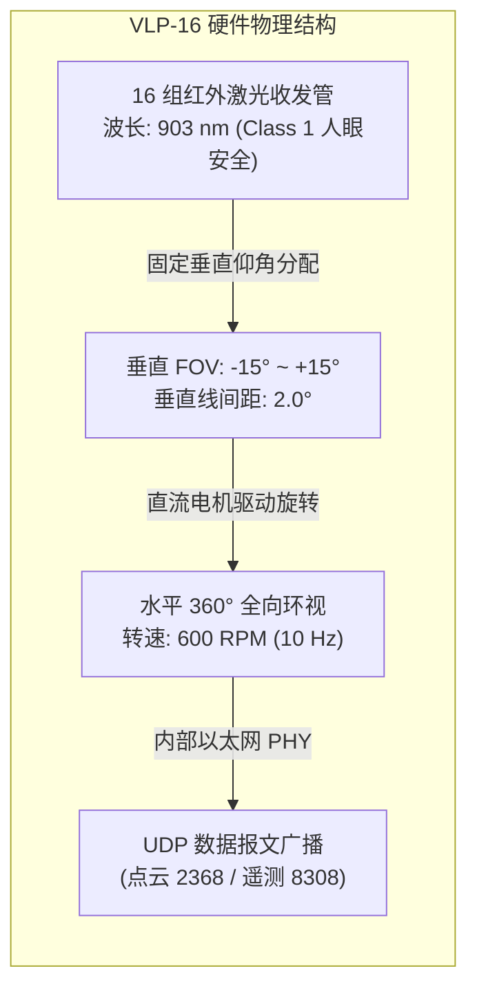
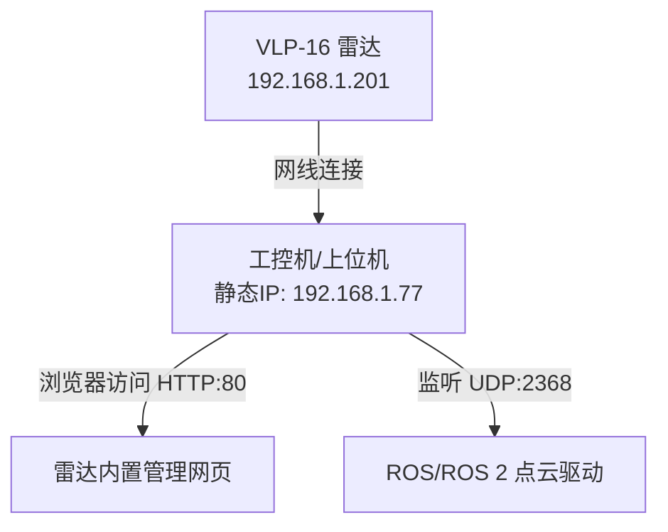

> [!abstract] 档案摘要
> **Velodyne Puck (VLP-16)** 是三维激光雷达发展史上的“行业标杆”。尽管近年来半固态与高线数雷达层出不穷，但 VLP-16 凭借其近乎完美的开源驱动生态、自带浏览器 Web 控制后台，依然是各大高校、RoboMaster 竞速战队和 SLAM 初学者接触 3D 激光惯导里程计（如 FAST-LIO、LIO-SAM）的首选入门硬件。
> 
> 上级总览：[[00_Radar档案_选型矩阵与传感器通用排错指南]]

---

## 一、物理测量机理与硬件参数

Velodyne VLP-16 内部集成了 16 对红外激光发射管与接收雪崩光电二极管（APD），机械光机结构在封闭壳体内以 300 ~ 1200 RPM 高速旋转，在三维立体空间内生成 16 根上下离散分布的环形切片点云。



### 1.1 核心电气与光学参数表

| 参数项 | 参数指标 | 备注说明 |
| :--- | :--- | :--- |
| **激光线数** | 16 线 | 沿垂直轴固定间隔分布 |
| **视场角 (FOV)** | 水平 $360^\circ$ / 垂直 $30^\circ$（$-15^\circ \sim +15^\circ$） | 垂直角分辨率严格为 $2.0^\circ$ |
| **最大测距距离** | $100\text{ m}$ | 针对一般漫反射物体有效测距约 $50\sim 80\text{ m}$ |
| **测距盲区** | 约 $0.4\text{ m} \sim 0.5\text{ m}$ | 距离雷达镜头太近的物体不返回有效点 |
| **测距精度** | 典型值 $\pm 3\text{ cm}$ | 依赖目标反射率与入射角 |
| **旋转转速** | 默认 $600\text{ RPM}$（对应 $10\text{ Hz}$） | 可在 Web 后台设置为 5~20 Hz (300~1200 RPM) |
| **单圈点数** | 约 $28,000 \sim 30,000$ 点/帧 | 单回波模式下，相当于 30 万点/秒 |
| **工作供电** | $9\text{V} \sim 32\text{V DC}$（推荐稳压 12V） | 典型功耗约 $8\text{W}$，启动瞬间电流达 $2.5\text{A}$ |
| **物理重量** | 约 $830\text{ g}$ | 紧凑型柱状结构 |

---

## 二、通信架构与初学者极速上电教程

与很多需要专有通信配置协议的工业雷达不同，VLP-16 内部内置了微型 Web 服务器和网络交换芯片，这使得它的上手极其直观。

### 2.1 物理接线与拓扑
* **电源接口**：连接稳压直流 12V 电源适配器。
* **网络接口**：RJ45 网线直接插入上位机电脑网卡，或经由工业千兆交换机中转。



### 2.2 上电三步法

#### 第一步：配置上位机静态 IP
雷达出厂默认 IP 为 **`192.168.1.201`**，因此上位机网卡必须配置在同一个网段（如 `192.168.1.77` 或 `192.168.1.100`）：
```bash
# 验证网络是否相通
ping 192.168.1.201
```
*能够 ping 通即表明物理供电与以太网链路完全建立。*

#### 第二步：浏览器打开配置后台（神级功能）
直接在电脑浏览器中输入：
```
http://192.168.1.201
```
你将直接看到雷达的实时 Web 管理控制台：
* **Motor RPM**：可直接输入 `600` 并点击 Set 调整转速；
* **Return Type**：选择激光回波类型（详见下方避坑）；
* **Laser State**：显示发射状态，且可在界面上直接重启雷达。

#### 第三步：启动 ROS 2 驱动
在 Ubuntu / ROS 2 系统中，官方驱动已原生支持，无需自行手写驱动代码：
```bash
# 1. 安装官方驱动包 (以 ROS 2 Humble 为例)
sudo apt update && sudo apt install ros-humble-velodyne

# 2. 启动驱动一键 Launch
ros2 launch velodyne velodyne-all-nodes-supporing-ntp.launch.py
```
此时系统将自动发布三维点云话题：
* 话题名称：`/velodyne_points`
* 消息类型：`sensor_msgs/msg/PointCloud2`

---

## 三、三维点云效果展示与 RViz 配置

打开 RViz2 后，通过以下步骤调出高质感三维点云：

1. **设置全局坐标系**：
   * 将 `Global Options` $\to$ `Fixed Frame` 填入 **`velodyne`**。
2. **添加 PointCloud2 插件**：
   * 点击左下角 `Add` $\to$ 选择 `PointCloud2`；
   * `Topic` 选择 **`/velodyne_points`**；
   * `Size (m)` 设为 `0.03`（点显示更清晰实心）；
   * `Color Transformer` 设为 **`Intensity`**（按反射率染色）或 **`AxisColor`**（按高程 Z 轴渐变）。
3. **视觉效果特征**：
   * 视野中呈现出清晰的 **16 条同心圆环激光轨迹**，打在地面上呈现由近及远的圆环扩展，打在墙面和立柱上则呈现明显的竖直排列线条。

---

## 四、深度优缺点客观剖析

### 4.1 核心优势
1. **开源生态“老大哥”，即插即用**：
   * 无论是 FAST-LIO2、LIO-SAM、Point-LIO 还是各种三维地面分割算法，默认支持最好的必定是 VLP-16。几乎不需要修改任何驱动转换代码。
2. **零工具依赖的 Web 配置**：
   * 不需要安装任何专有的 Windows 调试软件，有浏览器就能修改雷达网络 IP、转速和端口。
3. **空间 360° 全向覆盖**：
   * 水平 $360^\circ$ 无死角视野，机器人底盘无论是快速前进、横移还是小陀螺自旋，都不会丢失周围环境特征。

### 4.2 固有局限与硬伤
1. **垂直线数稀疏（仅 16 线）**：
   * 垂直角分辨率达 $2.0^\circ$。在 10 米外两根线之间的纵向间隔超过 $35\text{ cm}$，对于低矮障碍物（如路边牙子、坑洼、台阶边缘）极易发生“漏检踩空”。
2. **价格昂贵且机械发热**：
   * 属于早期机械式雷达，造价依然偏高；内部高速旋转机构长期运行外壳温度较高，高振动环境下存在一定的轴承磨损风险。
3. **存在近距离盲区**：
   * 雷达半径 $0.4\text{ m}$ 范围内无法测距，车体正下方或贴近雷达表面是完全不可见的。

---

## 五、实战避坑与深度排错指南（血泪经验）

### 坑 1：Web 后台的 Return Type（双回波陷阱）
* **【真实故障】**：
  在运行 FAST-LIO2 或 LIO-SAM 建图时，发现建出来的地图有重影、墙面变厚，并且后台计算延迟飙升，CPU 占用居高不下。
* **【原因拆解】**：
  VLP-16 支持三种回波模式：`Strongest`（最强回波）、`Last`（最后回波）和 `Dual`（双回波）。
  很多二手或库存雷达出厂默认配置为了 `Dual`。在双回波模式下，每束激光如果穿透树叶或玻璃会返回两次，导致**单圈点数翻倍（由 3 万点飙升至 6 万点）**，且大量点在几何上近乎重叠，极大加重算法的残差拟合负担。
* **【避坑解法】**：
  直连雷达打开 Web 后台，在配置项中将 **`Return Type`** 明确设为 **`Strongest`**（最强回波），然后点击保存重启。

---

### 坑 2：点时间戳（Point Time）倒退导致运动去畸变直接报废
* **【真实故障】**：
  机器人在静止时点云很漂亮，但只要底盘一跑起来，或者原地快速旋转，建出来的地图就严重扭曲、发生拉扯。
* **【原因拆解】**：
  在高速运动（如 $2\text{ m/s}$ 或 $180^\circ/\text{s}$）下，雷达转一圈需要 $100\text{ ms}$。在这 $100\text{ ms}$ 内，机器人其实在不断位移，这就是**运动畸变**。
  现代紧耦合 LIO（如 FAST-LIO2）依赖点云消息中每个点的 `time`（相对于该帧开头的微秒偏移）来配合高频 IMU 进行逐点反向补偿去畸变。如果官方驱动未配置 `timestamp_first_packet: true`，驱动计算出来的点时间戳可能会产生负数、全 0 或时间跳变，导致去畸变算法把点云反而“越算越歪”。
* **【避坑解法】**：
  在启动参数中检查并确保开启首包时间戳基准；或者在点云输入算法前，挂载一个简单的时钟规范化拦截器，确保每个点的时间偏移在 $[0, 0.1\text{s}]$ 区间内严格单调递增。

---

### 坑 3：宿主机 / 虚拟机 / Docker 中的 UDP 广播拦截
* **【真实故障】**：
  浏览器能够顺畅打开 `192.168.1.201` 网页，ping 也是几毫秒响应，但一跑 ROS 驱动，终端却一直卡在 `Waiting for packets...`。
* **【原因拆解】**：
  VLP-16 的点云数据是以 **UDP 广播/组播** 方式向局域网广播的。系统的防火墙（Ubuntu 的 `ufw` 或 Windows Defender）常常放行 TCP（所以网页能打开），却静默拦截了端口 `2368` 的入站 UDP 数据。
  如果是 Docker 容器部署，如果未加 `--net=host` 参数，Docker 的桥接 NAT 网络也无法转发广播报文。
* **【避坑解法】**：
  * 在主机终端执行关闭或放行端口命令：
    ```bash
    sudo ufw allow 2368/udp
    ```
  * Docker 运行时务必指定网络模式为主机模式：`--net=host`。
