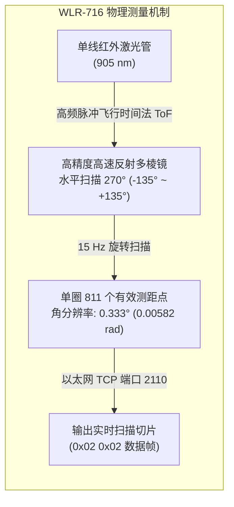

> [!abstract] 档案摘要
> **万集（VanJee）WLR-716** 是一款广泛应用于工业仓储 AGV、服务机器人底盘和工业安全避障的二维单线激光雷达。
> 与科研级别的机械旋转雷达不同，WLR-716 拥有极其坚固的全金属密封外壳、超宽的 $270^\circ$ 扇形视场角与密集的 811 点角分辨率。由于其无内置 Web 界面，且采用独具特色的“TCP 握手激活”机制，初学者在初次点亮和调试时往往容易踩坑。
> 本篇系统总结其通信机理、未知 IP 嗅探方法、驱动配置及关键实战避坑经验。
> 
> 上级总览：[[00_Radar档案_选型矩阵与传感器通用排错指南]]

---

## 一、物理测量机理与硬件参数

万集 WLR-716 内部采用单组高功率红外半导体激光管，通过内部高速多面反射棱镜实现水平方向单线扫描，在雷达所在物理高度上切出一条清晰致密的“二维横断面”。



### 1.1 核心技术指标表

| 参数项 | 参数指标 | 备注说明 |
| :--- | :--- | :--- |
| **空间维度** | 单线二维水平扫描（2D 切片） | 类似房间横切轮廓 |
| **视场范围 (FOV)** | $270^\circ$（$-135^\circ \sim +135^\circ$） | 正前方为 $0^\circ$，左右各拓展 $135^\circ$ |
| **单帧点数 / 角分辨率** | **811 点/帧** / 约 $0.333^\circ$ ($0.00582\text{ rad}$) | 在 2D 雷达中属于非常密集的点阵 |
| **扫描频率** | 稳定 $15\text{ Hz}$（每秒更新 15 圈） | 对应帧间周期约 $66.7\text{ ms}$ |
| **有效测距范围** | $0.05\text{ m} \sim 25\text{ m}$（部分型号可达 55m） | 工业近距盲区仅 $5\text{ cm}$ |
| **测距精度** | $\pm 10\text{ mm} \sim \pm 20\text{ mm}$ | 工业漫反射测量精度 |
| **通信物理接口** | 100M RJ45 以太网口，M12 工业航空插头或直出线 | 采用 **TCP Client-Server** 通信（默认端口 2110） |
| **供电标准** | 宽压 $9\text{V} \sim 28\text{V DC}$（推荐 12V / 24V） | 整机功耗 $< 5\text{W}$，全天候工业级发热极小 |
| **防护等级** | 全铝合金密封机身，IP67 工业级防尘防水 | 抗震抗冲击性能优异 |

---

## 二、通信架构与“握手激活”机制解析

### 2.1 为什么它没有 Web 配置网页？
工业雷达为了追求最高的系统可靠性与极简固件，摒弃了资源开销大的 HTTP 服务。它使用专有的二进制套接字协议（TCP/IP）。

### 2.2 独具特色的“握手激活控制帧”
WLR-716 在物理上电后，**并不会主动狂喷激光点云**。
1. **TCP 建立连接**：上位机（工控机）作为 Client 连接雷达的 IP 与 `2110` 端口。
2. **主动激活握手**：上位机必须向雷达写入一串特定的 **34 字节十六进制控制指令**：
   ```
   FF AA 00 1E 00 00 00 00 00 00 01 01 00 05 00 00 
   00 00 00 00 00 00 05 01 00 00 00 00 00 00 00 1F EE EE
   ```
3. **点云持续推流**：雷达解析校验该指令通过后，内部激光管正式打光，并源源不断以 `0x02 0x02 0x02 0x02` 为包头回传测距点云报文。

---

## 三、初学者极速上电与点亮教程

### 3.1 核心难题：不知道出厂 IP 怎么办？（网络探针抓包法）
工业雷达在流通或上一任项目使用后，IP 往往被改成非默认网段（如 `192.168.100.104`、`192.168.0.2` 等）。由于没有屏幕和 Web 界面，盲测 IP 极为痛苦。

> [!TIP] 极简嗅探秘籍：利用雷达上电广播寻址
> 1. 将雷达通过网线直连电脑网口。
> 2. 电脑终端运行抓包工具（排除本机的 IPv6 和常见广播噪声）：
>    ```bash
>    sudo tcpdump -i <网卡名> -n -e -c 30 'not ip6 and not arp'
>    ```
> 3. **将雷达电源拔掉，重新插上（上下电）**。
> 4. 雷达在开机初始化的微秒级时间内，底层网卡芯片一定会向局域网广播 ARP 或握手心跳包。此时屏幕上跳出的那个非电脑本机源 IP（如 `192.168.100.104`），**就是雷达当前的真实 IP！**

### 3.2 配置主机网卡与驱动启动
1. **设置电脑同网段静态 IP**：
   * 假设雷达真实 IP 为 `192.168.100.104`，电脑网卡设为 `192.168.100.222`，子网掩码 `255.255.255.0`。
   * 验证连通性：`ping 192.168.100.104`。
2. **编译并启动 ROS 2 驱动**：
   ```bash
   # 启动驱动节点，指定雷达实际 IP 与端口
   ros2 launch wj_716_lidar wj_716_lidar.launch.py hostname:=192.168.100.104 port:=2110
   ```
3. **验证数据流**：
   ```bash
   ros2 topic hz /scan
   # 预期输出: average rate: 15.000 Hz
   ```

### 3.3 RViz2 可视化配置技巧
1. 在 Displays 中添加 **`LaserScan`** 插件，Topic 填写 **`/scan`**。
2. **调整点云饱满度**：
   * 将 `Style` 从细小的 `Points` 改为 **`Flat Squares`**（小方块）。
   * `Size (m)` 设为 **`0.05`**（点在视觉上会连成一条坚实的实心轮廓）。
3. **颜色渲染**：
   * `Color Transformer` 设为 **`AxisColor`** 并勾选 `Use rainbow`，周围障碍物会根据距离呈现出红、黄、绿、紫的渐变色。

---

## 四、深度优缺点客观剖析

### 4.1 核心优势
1. **工业级鲁棒性与防护**：
   * 全金属铝合金外壳，IP67 防护，能在高粉尘、潮湿或轻微碰撞的复杂车间工况下 7x24 小时无故障运行。
2. **极高的平面角分辨率（$0.33^\circ$）**：
   * 270° 内分布 811 个点。相比消费级雷达（360 点），打在墙面上的切片线条极其平整，没有毛刺，非常利于 2D 轮廓提取与几何线匹配。
3. **算力开销几近为零**：
   * 单帧数据量极小，在嵌入式单板电脑（如香橙派、树莓派）上运行驱动与 Cartographer 2D 建图，CPU 占用率通常不足 $10\%$。

### 4.2 固有局限与硬伤
1. **单一维度的物理盲区**：
   * 无法感知高度信息。如果地面存在凸起的电线槽、微小台阶，或者上方存在悬空的桌沿、机械臂，2D 雷达会直接“视而不见”。
2. **颠簸环境下的“假障碍物”**：
   * 车体发生俯仰角晃动（Pitch）或遇到减速带时，原本水平发射的激光线会瞬间打在地面上，导致导航系统误以为正前方出现高耸障碍物而紧急刹车。
3. **TCP 连接的排他性锁死**：
   * 雷达只允许一个 TCP 客户端连接。前一个进程如果不释放端口，后续任何程序都无法连入。

---

## 五、实战避坑与深度排错指南（血泪经验）

### 坑 1：RViz 视口一片漆黑，报 `Frame [laser] does not exist`
* **【真实故障】**：
  终端打印连接成功，`/scan` 话题接收正常且在 RViz 里打了绿勾（Status: OK），但 3D 视口中心空无一物，上方出现黄色叹号：`Global Status: Warn: Frame [laser] does not exist`。
* **【原因拆解】**：
  ROS 2 的 RViz 在渲染点云时，必须依赖系统内部的 **TF 坐标树（Transform Tree）**。很多开源或厂家提供的 2D 驱动只负责解析并发布 `/scan`（其消息头带有 `frame_id: "laser"`），但**没有广播坐标系之间的变换关系**。RViz 的坐标变换管理器找不到雷达中心在三维空间的定位，直接拒绝投射点云。
* **【避坑解法】**：
  在 Launch 启动文件中集成一个静态 TF 广播器（或在终端单独启动）：
  ```bash
  ros2 run tf2_ros static_transform_publisher --frame-id map --child-frame-id laser
  ```
  广播一出，RViz 的 `Global Status` 瞬间转为绿色的 OK，点云即刻显现。

---

### 坑 2：TCP 单客户端连接锁死（Connection Timeout 迷局）
* **【真实故障】**：
  刚才测试脚本还能正常收到数据，中断脚本再运行官方驱动，驱动却一直报 `Initial connection failed / connect timed out`，再也无法连上。
* **【原因拆解】**：
  WLR-716 的固件非常严格，其 2110 端口为**单一 Client 排他机制**。如果之前的测试程序被强行 `Ctrl+Z` 挂起、异常崩溃导致底层 Socket 未走完四次挥手（处于操作系统 `TIME_WAIT`），雷达端会认为“当前已有客户端在线”，从而无视一切新的 TCP 握手请求。
* **【避坑解法】**：
  1. 彻底杀死系统内所有占用网口的后台残留进程；
  2. 最干净利落的方法：**将雷达断电 3 秒后重新插上**，强行复位雷达内部的 Socket 状态机。

---

### 坑 3：官方开源驱动中的心跳机制判定 Bug（两秒必掉线）
* **【真实故障】**：
  驱动连上雷达后，正常输出了 2 秒钟的点云，随后控制台突然报错 `Reconnecting to...`，然后陷入反复断连重连的无限循环。
* **【原因拆解】**：
  深入厂家源码会发现，驱动内部的连接监视定时器绑定了一个 `heartstate` 布尔变量。当且仅当接收到 `0xFF 0xAA` 类型的参数应答报文时，代码才会把 `heartstate = true`。
  但物理雷达在接收到激活指令后，便进入全速数据推流状态，持续发送的都是 `0x02 0x02` 的激光扫描包，不再重复发送心跳帧。驱动在 2 秒后检查发现 `heartstate == false`，便误判“雷达已死”，主动 `close()` 切断了 Socket！
* **【避坑解法】**：
  修改协议层解析逻辑：在接收到正常的 `0x02 0x02` 点云数据帧时，同样刷新存活标志位，使驱动认识到“数据流在涌入即代表设备存活”，彻底杜绝误判掉线。

---

### 坑 4：初学者疑惑“为什么点云只有周围一圈？”
* **【初学者误解】**：
  很多接触过 3D 雷达的同学初次看到 WLR-716 的显示，会误以为“点云太稀疏，中间全是空的”。
* **【物理机理解释】**：
  这是由 **2D 单线雷达的物理本质** 决定的。它不是 3D 立体扫描，它只有一束激光在一个固定的水平切面上旋转。激光打到周围的墙壁、桌腿后反射回来，因此在空间中必然只呈现出雷达所在高度的一圈闭合轮廓线。雷达到墙壁之间空旷的平地是没有遮挡物的，自然不会有点。
