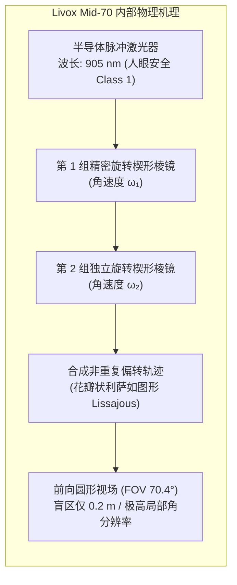

> [!abstract] 档案摘要
> **大疆览沃 Livox Mid-70** 是面向低速移动机器人、自动驾驶盲区补盲与室内高精度感知的标志性**双棱镜非重复扫描固态激光雷达**。
> 凭借其独特的圆形大视场（$70.4^\circ$）、低至 $0.2\text{ m}$ 的超近测距盲区、高可靠无旋转外壳设计，以及随着积分时间增加而近乎 100% 覆盖的点云特性，Mid-70 在 RoboMaster 竞速车、室内 AGV、商用清洁机器人和高校三维 SLAM（如 FAST-LIO2、FAST-LIVO2）开发中获得了极其广泛的应用。
> 
> 上级总览：[[00_Radar档案_选型矩阵与传感器通用排错指南]]
> 下游算法关联：[[Great Github/SLAM建图]]（FAST-LIO 与 FAST-LIVO2）

---

## 一、物理测量机理与硬件参数

传统机械式激光雷达（如 Velodyne VLP-16）依赖整个光学收发模组在电机驱动下 $360^\circ$ 匀速旋转，垂直方向线束固定；而 Livox Mid-70 采用的是创新的**双楔形棱镜（Risley Prisms）偏转非重复扫描技术**。



### 1.1 非重复扫描的“时空积分”本质
* **空间覆盖率随时间演进**：
  * 单帧（$10\text{ Hz} / 100\text{ ms}$）瞬时视场覆盖率约 $20\%$，呈现放射状的花瓣斑纹；
  * 当车体悬停或积分时间达到 $0.5\text{ s} \sim 1.0\text{ s}$ 时，视场覆盖率跃升至 $90\% \sim 100\%$，等效于数百线高线数机械雷达的致密效果。
* **抗振动与可靠性**：内部仅小体积轻量化棱镜高速偏折，整体封装为密闭固态结构（IP67），彻底消除了机械多线雷达旋转滑环磨损断信号的隐患。

### 1.2 核心电气与光学参数表

| 参数项 | 参数指标 | 备注说明 |
| :--- | :--- | :--- |
| **激光波长** | $905\text{ nm}$ | Class 1 人眼安全标准（IEC 60825-1:2014） |
| **视场角 (FOV)** | 圆形视场 $70.4^\circ$（水平与垂直均为 $70.4^\circ$） | 适合小车车头前向感知或大角度盲区补盲 |
| **有效测距范围** | $0.2\text{ m} \sim 260\text{ m}$（目标反射率 $80\%$）<br/>$0.2\text{ m} \sim 90\text{ m}$（目标反射率 $10\%$） | 赛场/室内常见物体有效范围一般在 $0.2\sim 30\text{ m}$ |
| **近距测距盲区** | **仅 $0.2\text{ m}$（$20\text{ cm}$）** | **核心杀手锏**：远优于机械雷达常见的 0.4~0.8m 盲区 |
| **测距精度** | $1\sigma < 2\text{ cm}$（在 $20\text{ m}$ 漫反射条件下） | 极低系统测距噪声 |
| **点频 (Point Rate)** | $100,000\text{ pts/s}$（单回波模式）<br/>$200,000\text{ pts/s}$（双回波模式） | 典型 $10\text{ Hz}$ 输出帧率，每帧约 1 万点 |
| **角度精度** | $< 0.1^\circ$ | 高精度法向量估计基础 |
| **工作供电与功耗** | 宽压 $10\text{V} \sim 15\text{V DC}$（推荐稳定 $12\text{V}$） | 稳态功耗约 $8\text{W} \sim 10\text{W}$，冷机启动瞬时可达 $2\text{A}$ |
| **防护等级** | $\text{IP67}$ 级密封 | 适应潮湿、灰尘与恶劣工业场景 |
| **数据与同步接口** | $100\text{ Mbps}$ 以太网（RJ45/航空插头）<br/>同步支持 IEEE 1588-2008 (PTPv2)、PPS 硬件对时 | 默认使用 UDP 报文通信 |

---

## 二、通信架构与驱动协议机制解析

### 2.1 物理接线与供电
1. **转接盒（Livox Converter 2.0）**：
   * **电源输入**：接 $12\text{V}$ 直流电源（严禁接入 $24\text{V}$，超出 $15\text{V}$ 极易烧毁内部电路）。
   * **网线端口**：直连上位机（工控机、SER5 或笔记本网卡）。
   * **雷达航空插头**：旋紧插入 Converter 对应端口。

### 2.2 网络拓扑与广播码机制
与普通即插即用的机械雷达不同，Livox 设备采用**广播码白名单与主动握手机制**：
* **广播码（Broadcast Code）**：
  * 每台 Mid-70 出厂时机身背面贴纸刻有唯一的 14 位字符编号（例如：`3GGDJ3C00100771`）。
  * 驱动节点启动时，必须在配置文件中声明此广播码，上位机才会向对应雷达发起连接握手并开启数据采集流。
* **默认 IP 地址逻辑**：
  * Mid-70 支持动态与静态 IP 配置（出厂通常处于同一网段广播握手态）。
  * 建议上位机将有线网卡配置为固定静态 IP，例如：`192.168.1.50`，子网掩码 `255.255.255.0`。

---

## 三、ROS 2 驱动与 Livox CustomMsg 核心细节

### 3.1 驱动技术选型：Livox-SDK 与 livox_ros2_driver
* **Livox-SDK / Livox-SDK2**：大疆底层的 C++ 通信开发套件，负责底层 UDP 报文解析、广播码侦听与心跳维持。
* **livox_ros2_driver**：ROS 2 封装驱动节点，输出雷达数据流。

### 3.2 配置文件关键参数详解 (`livox_lidar_config.json`)
```json
{
  "lidar_summary_info": {
    "lidar_type": 1
  },
  "buffer_size": 32,
  "cmd_data_port": 56000,
  "timesync_config": {
    "device_name": "livox_lidar_device",
    "comm_type": "PTP"
  },
  "lidar_configs": [
    {
      "ip": "192.168.1.1XX",
      "pcl_data_type": 1,
      "pattern_mode": 0,
      "extrinsic_parameter": {
        "roll": 0.0,
        "pitch": 0.0,
        "yaw": 0.0,
        "x": 0,
        "y": 0,
        "z": 0
      }
    }
  ],
  "user_config": {
    "user_ip": "192.168.1.50",
    "user_port": 56000,
    "user_broadcast_code": "3GGDJ3C00100771"
  }
}
```

> [!important] 为什么必须使用 `CustomMsg` 而非标准 `PointCloud2`？
> 标准 ROS 的 `sensor_msgs/msg/PointCloud2` 默认全帧所有点共享同一个头部时间戳（`header.stamp`）。
> 但 Mid-70 是非重复扫描，一个 $100\text{ ms}$ 的帧窗口内，前 10ms 扫描的点与后 90ms 扫描的点空间位置存在时间连续差异。
> `livox_ros2_driver/msg/CustomMsg` 在自定义消息中为**每一个激光点赋予了相对帧头的微秒级偏移时间**：
> ```cpp
> uint32 offset_time  # 纳秒/微秒级相对首点的时间差
> float32 x
> float32 y
> float32 z
> uint8 reflectivity
> uint8 tag
> uint8 line
> ```
> 紧耦合算法（如 FAST-LIO2、Point-LIO）利用该字段在反向传播中实现**逐点精确运动畸变补偿（Motion Undistortion）**。若被转换为普通 `PointCloud2` 丢失逐点时间戳，机器人高速机动建图时点云会发生严重的拉扯和重影！

---

## 四、深度优缺点客观剖析

### 4.1 核心优势（Why Mid-70?）
1. **盲区极小（仅 $0.2\text{ m}$）**：
   * 普通机械雷达盲区 $0.4\sim 0.8\text{ m}$，安装在底盘车头时，车体正前方的低矮台阶、地面木块、小纸箱完全处于视线盲区。Mid-70 能贴地测到 $20\text{ cm}$ 处微小起伏，对移动机器人高程建图与脱困至关重要。
2. **正面大视野高密度聚焦**：
   * $70.4^\circ$ 圆形 FOV 将全部 $10\text{ 万点/秒}$ 能量集中倾注在机器人前进方向，等效于数十线以上机械雷达在正前方的点密度，极其适合走廊、通道和赛道场景。
3. **固态结构，抗冲击震动**：
   * 无外露旋转头，没有轴承抖动磨损，适应工业巡检车高频过坎振动。
4. **超低价格与极佳性价比**：
   * 相比动辄数万元的 16 线/32 线机械雷达，Mid-70 的成本仅为其数分之一。

### 4.2 客观局限与挑战
1. **非 $360^\circ$ 环视，倒车与大回环受限**：
   * 仅前向 $70.4^\circ$ 锥形视野，小车横移、后退或原地掉头时，若无多模态传感器（IMU、里程计或相机）约束，纯激光 ICP 极易发生退化。
2. **瞬态帧稀疏斑纹，传统线束算法完全失效**：
   * 无法使用针对传统机械雷达按线分类设计的算法（如 LeGO-LOAM、A-LOAM）；必须使用增量式体素/直接法算法（如 FAST-LIO2）。
3. **非重复扫描带来的动静态点混合**：
   * 视场内有移动人影或移动小车穿过时，非重复光束会扫出“拖影羽毛”，需要算法后端增加动态点滤波或离群点剔除策略。

---

## 五、实战避坑与深度排错指南（血泪经验）

### 坑 1：广播码（Broadcast Code）未配置或多余前缀，雷达静默
* **现象**：
  驱动终端打印：
  ```text
  Commandline input bd:livox0000000001
  Invalid bd:livox0000000001!
  ```
  随后驱动不报错退出或一直显示 `LiDAR: 0.0 Hz`。
* **原因**：
  Livox 驱动中如果没有在启动参数中显式传入雷达机身贴纸上的广播码，驱动会使用默认的占位符 `livox0000000001`。
* **解法**：
  检查机身贴纸（例如 `3GGDJ3C00100771`），在启动参数中传入 `bd_list:="3GGDJ3C00100771"`，或在 `livox_lidar_config.json` 的 `user_broadcast_code` 中填入正确字串。

---

### 坑 2：旧进程残留导致网口被占，重启后 LiDAR 0.0 Hz
* **现象**：
  上一次调试建图异常退出后，重新启动 launch，发现 IMU 数据正常，但 LiDAR 始终维持在 `0.0 Hz`，`ping 192.168.10.17` 正常。
* **原因**：
  Livox-SDK 底层打开了 `56000` / `65000` 范围的 UDP 端口。如果之前的节点通过不彻底的方式终止（如仅关闭了 launch wrapper，但 `livox_ros2_driver_node` 成为孤儿进程），新进程无法绑定端口并完成握手。
* **解法**：
  启动前执行强力清理并稍作等待：
  ```bash
  pkill -9 -x livox_ros2_driv || true
  sleep 2
  ping -c 2 -W 1 192.168.10.17
  ```
  确认网卡链路恢复后再拉起新节点。

---

### 坑 3：静止状态下点云过稀退化导致 SLAM 姿态发散
* **现象**：
  车体在原地静止时，FAST-LIO / FAST-LIVO2 的位姿角速度或高度突然以几十米/秒狂飙发散（NaN 或飞出视野）。
* **原因**：
  Mid-70 单帧点数受限，若体素网格（`voxel_size`）划分过细（例如设置了小于 $0.2\text{ m}$），静止时当帧命中的面特征不足（例如有效特征面数 $< 6$），协方差矩阵退化奇异，求逆后状态协方差瞬间爆炸。
* **解法**：
  1. **代码级退化保护**：在 `voxel_map.cpp` 的 `StateEstimation` 求解前添加有效特征面约束断言：
     ```cpp
     if (effct_feat_num_ < 6) {
         RCLCPP_WARN(rclcpp::get_logger("voxel_map"), "No effective surface feature, skip estimation!");
         return;
     }
     ```
  2. **体素与降采样调优**：室内赛场场景将 `filter_size_surf` 调整为 `0.08`，`voxel_size` 调整为 `0.35 ~ 0.40`，保证即使在近距离墙面也能有足够多的空间平面参与约束。

---

### 坑 4：电源供电线压降与冷机启动冲击
* **现象**：
  雷达常温下通信几分钟后，只要机器人车体电机一加速，雷达网口突然断联，驱动报错 `Device lost connection`。
* **原因**：
  Mid-70 工作电压要求必须在 $10\text{V} \sim 15\text{V}$。底盘动力电机大电流抽动瞬间，电池端电压可能会瞬间拉低跌破 $9.5\text{V}$，触发 Converter 欠压复位保护。
* **解法**：
  传感器供电线路**必须与动力电机供电线路隔离**，采用大功率升降压稳压模块（如专用稳压 $12\text{V}/5\text{A}$ 输出模块），并并联电容滤波，杜绝瞬态欠压。

---

### 坑 5：多传感器融合（LIVO）中的时间戳与曝光拉扯
* **现象**：
  与彩色相机（如 Berxel iHawk 100Q、Astra Pro）组建 FAST-LIVO2 时，静止状态下 VIO 和 LIO 姿态角持续反向对抗（$\pm 0.5^\circ \sim 1.0^\circ$ 互顶），$Z$ 轴速度持续被 VIO 推入负值。
* **原因**：
  相机开启了硬件自动曝光（Auto Exposure），导致 FAST-LIVO2 内部的曝光估计变量 `inv_expo_time` 被剧烈拉扯，进而破坏直接法光度残差雅可比矩阵；叠加 Mid-70 与相机的帧时间戳偏移未对齐，引发多模态滤波对抗。
* **解法**：
  1. 采用固定曝光模式，或在 FAST-LIVO2 参数中将 `exposure_estimate_en` 设为 `false`；
  2. 收紧 IMU 协方差（`gyr_cov: 0.01`, `acc_cov: 0.1`），适当增大视觉光度协方差 `img_point_cov: 2500`，由稳健的 LIO 几何主导定位，VIO 提供高频辅助与退化兜底。

---

## 六、工程代码与部署参考

* **雷达适配桥接节点**：`livo2_sensor_adapter`（负责对齐 Mid-70 CustomMsg 时间戳与相机硬件翻转 `flip_180`）
* **建图启动指令**：
  ```bash
  ros2 launch livo2_sensor_adapter livo2_mapping_bringup.launch.py \
    scene:=rc_indoor mode:=mapping map_name:=latest rviz:=false
  ```
