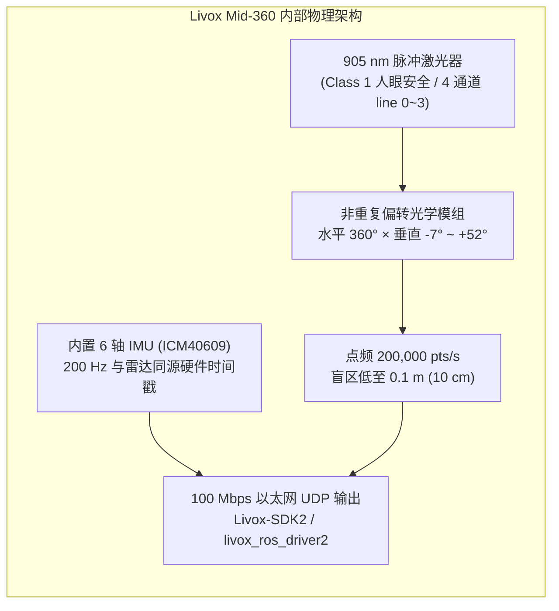

> [!abstract] 档案摘要
> **大疆览沃 Livox Mid-360** 是新一代**混合固态 $360^\circ$ 全向非重复扫描激光雷达**，也是目前足式机器人、全向底盘、无人机避障和复杂楼梯/室内外 3D SLAM 的主流主力传感器。
> 它兼具 **Mid-70 的极小盲区（$0.1\text{ m}$）+ 非重复致密采样** 与 **VLP-16 的水平 $360^\circ$ 全向视场**，并在机身内部直接集成 **200 Hz 六轴 IMU** 与网口直连供电（无需笨重转接盒），配合 **Livox-SDK2 / `livox_ros_driver2`** 可直接驱动 FAST-LIO2 与高精度 2.5D 高程图建图。
> 本档案同时涵盖 **标准零售版 Mid-360** 与 **大疆农业 Agras（如 T100）定制版 Mid-360** 的协议差异、唤醒解锁与避坑实战。
>
> 上级总览：[[00_Radar档案_选型矩阵与传感器通用排错指南]]
> 同系对比：[[03_大疆览沃_Livox_Mid-70_固态激光雷达从零上手与避坑实战]]

---

## 一、物理测量机理与硬件参数

Mid-360 采用**旋转反射镜 + 激光收发模组**的混合固态非重复扫描架构：内部单轴高速旋转的同时配合折射光学器件改变出射俯仰角，在水平 $360^\circ$、垂直 $-7^\circ \sim +52^\circ$（总垂直视场 $59^\circ$）的半球形立体空间内打出非重复扫描点云。



### 1.1 核心电气与光学参数表

| 参数项 | 参数指标 | 实战意义与备注 |
| :--- | :--- | :--- |
| **激光波长** | $905\text{ nm}$ | Class 1 人眼安全标准（IEC 60825-1:2014） |
| **视场角 (FOV)** | **水平 $360^\circ$ / 垂直 $59^\circ$（$-7^\circ \sim +52^\circ$）** | 向上视野极广，但平装时向下仅 $-7^\circ$（楼梯/近地建图需注意倾角） |
| **近距测距盲区** | **$0.1\text{ m}$（$10\text{ cm}$）** | 优于 VLP-16（0.4~0.5m）与 Mid-70（0.2m） |
| **有效测距范围** | $40\text{ m}$ @ $10\%$ 反射率<br/>$70\text{ m}$ @ $80\%$ 反射率 | 室内走廊、楼梯间、园区中庭主力工作区 |
| **测距精度** | $\le 2\text{ cm}$（$1\sigma$ @ $10\text{ m}$）；近距 $\le 3\text{ cm}$ | 足够支撑 $2.5\sim 4\text{ cm}$ 分辨率精细台阶高程图 |
| **点频 (Point Rate)** | **$200,000\text{ pts/s}$**（每 $10\text{ Hz}$ 帧约 2 万点） | 单帧密度是 Mid-70（10万点/秒）的 **2 倍** |
| **内置 IMU** | **200 Hz** 6 轴 IMU | 标称外参偏移 `extrinsic_T = [-0.011, -0.02329, 0.04412]` m |
| **供电与功耗** | $9\text{V} \sim 27\text{V DC}$（推荐 12V/24V 稳压） | 平均功耗约 $6.5\text{ W}$，低温启动峰值略高 |
| **防护与重量** | **IP67** / 仅约 **$265\text{ g}$** | 一体化航空插头（电源+百兆以太网+时间同步），无需外置 Converter |

---

## 二、标准版 vs 大疆农业 Agras 定制版 Mid-360 差异（核心必看）

如果手里使用的是无人机/农业机拆机的 **Agras / T100 定制版 Mid-360**，其固件网络、端口、状态机和内置 IMU 极性与标准零售版存在本质差异，直接套用官方默认配置必然收不到点云或建图炸飞：

| 对比维度 | 标准零售版 Mid-360 | Agras / T100 定制版 Mid-360（实机实测） |
| :--- | :--- | :--- |
| **底层 SDK** | 官方 `Livox-SDK2` + `livox_ros_driver2` | 隔离编译定制 `Livox-SDK2`（如 `agras_mid360/sdk_install`），跳过标准探测直接进入采样流 |
| **设备 IP / 主机 IP** | 默认 `192.168.1.1XX`（支持广播发现与改 IP） | 固件写死：雷达 **`192.168.1.10`** $\to$ 目标主机 **`192.168.1.20`**（掩码 `/24`） |
| **UDP 端口体系** | 控制 `56100` / 推送 `56200` / 点云 `56300` / IMU `56400` | 控制 **`60000`** / 点云 **`60001`** / IMU **`60003`** / 日志 `56500` |
| **上电默认状态** | 上电握手后自动开始扫描出点 | **默认处于待机 (`target_state=2`) 或行业 ROI 扇区裁剪**，必须先经 UDP 60000 发 `0x55` 协议唤醒解锁 |
| **内置 IMU 坐标系** | 标准 Livox IMU 轴向 | **Agras 固件内置 IMU 三轴全反向（`-x-y-z`）**，属于镜像变换，必须在驱动数据层翻转轴向 |
| **无外置授时表现** | 依赖 `PTPv2 / gPTP` 或驱动打主机时间 | 无外部授时（`time_type=0`），需驱动以首包对齐雷达硬件时钟与主机时钟，防点云与 IMU 时基撕裂 |

---

## 三、通信架构与 ROS 2 驱动配置

### 3.1 物理接线与网络验证
1. **供电与网口**：使用 3-in-1 航插尾线接入 **12V~24V 稳压电源**，百兆网线直连上位机/开发机网卡。
2. **静态 IP 与端口放行**：
   * 标准版：上位机设 `192.168.1.50/24`（或与 `MID360_config.json` 中 `host_net_info` 一致）。
   * Agras 版：上位机**必须**拥有 **`192.168.1.20/24`**，并放行 UDP `60000, 60001, 60003`。
   ```bash
   # Agras Mid-360 连通性与 UDP 60001/60003 抓包自检
   bash /home/wgk/agras_mid360/probe_agras.sh
   ```

### 3.2 Agras $360^\circ$ 全向解锁机制（`0x55` 协议）
Agras Mid-360 上电后若不发送解锁指令，要么完全不出点（待机），要么只输出受限扇区（ROI 裁剪）：
```bash
# 只读查询当前 target_state 与 ROI 裁剪窗口
python3 /home/wgk/agras_mid360/agras_unlock_360.py --check

# 解锁完整 360° 全周扫描 (roi_en=0, target_state=1, 绑定推流IP为 192.168.1.20)
python3 /home/wgk/agras_mid360/agras_unlock_360.py --unlock

# 被动监听 UDP 60001 验证 12 个 30° 扇区是否全部覆盖
python3 /home/wgk/agras_mid360/check_fov_360.py --seconds 3.0
```

### 3.3 驱动与 FAST-LIO 关键配置 (`AGRAS_MID360_config.json` & YAML)

`livox_ros_driver2` 针对 Mid-360 必须使用 **`lidar_type: 8`**（SDK2 协议族），而 **FAST-LIO** 中则应配置为 **`lidar_type: 1`**（Livox `CustomMsg` 逐点偏置时间戳格式）：

```json
// AGRAS_MID360_config.json 核心片段
{
  "lidar_summary_info": { "lidar_type": 8 },
  "MID360": {
    "lidar_net_info": {
      "cmd_data_port": 60000, "push_msg_port": 60000,
      "point_data_port": 60001, "imu_data_port": 60003, "log_data_port": 56500
    },
    "host_net_info": {
      "cmd_data_ip": "192.168.1.20", "cmd_data_port": 60000,
      "push_msg_ip": "192.168.1.20", "push_msg_port": 60000,
      "point_data_ip": "192.168.1.20", "point_data_port": 60001,
      "imu_data_ip": "192.168.1.20", "imu_data_port": 60003
    }
  },
  "lidar_configs": [{
    "ip": "192.168.1.10",
    "pcl_data_type": 1,
    "pattern_mode": 0
  }]
}
```

FAST-LIO 侧关键参数对比（内置 IMU vs 外置高精度 IMU）：

| 参数项 | 内置 Livox IMU (`agras_mid360.yaml`) | 外置串口 IMU (`agras_mid360_ext.yaml`, 如 L431_ADI) |
| :--- | :--- | :--- |
| **`common.time_sync_en`** | `false`（同 SDK 时钟基线已对齐） | **`true`**（无硬件同步时开启软件时间对齐） |
| **`preprocess.lidar_type`** | `1`（`livox_ros_driver2/msg/CustomMsg`） | `1`（`livox_ros_driver2/msg/CustomMsg`） |
| **`preprocess.scan_line`** | `4`（Mid-360 共 4 个激光通道） | `4` |
| **`preprocess.timestamp_unit`** | `3`（`US` 微秒级） | `3`（`US` 微秒级） |
| **`mapping.extrinsic_T`** | `[-0.011, -0.02329, 0.04412]` | 按实际机械安装尺寸实测填写（如 `[0.089, 0.01, -0.21]`） |

> [!tip] 为什么推荐走 `xfer_format = 1` (`CustomMsg`)？
> Mid-360 每帧 `100 ms` 窗口包含约 2 万个非重复扫描点，且支持任意安装倾角。`CustomMsg` 为每一点携带微秒级 `offset_time`，FAST-LIO 在 `avia_handler` 中可直接提取精确相对时间戳做反向传播运动去畸变，避免使用 `PointCloud2` 时退化到“依赖水平安装假设的方位角推算时间”分支。

---

## 四、深度优缺点客观剖析

### 4.1 核心优势（Why Mid-360?）
1. **$360^\circ$ 全向视场 + $0.1\text{ m}$ 极小盲区**：兼具 VLP-16 的全周环视抗退化能力与固态雷达的超近测距能力，在狭小楼梯间、走廊拐角、过门框场景几乎无视觉死角。
2. **$20\text{ 万点/秒}$ 高密度采样**：单位时间点数是 Mid-70 的两倍，静止或低速推进 $0.3\sim 0.5\text{ s}$ 即可将楼梯踏面与踢面覆盖密实，非常适合 $2.5\sim 4\text{ cm}$ 精细高程图。
3. **自带 200 Hz IMU，即插即用**：单网线+电源线即可开跑 LIO，省去外置 IMU 机械标定与硬同步接线烦恼（对更高动态场景仍可外接 500 Hz 高精度 IMU）。
4. **体积小、功耗低、固态耐摔**：仅 $265\text{ g}$、$6.5\text{ W}$、IP67，适合小型四足、轮腿及轻量化手持/背负建图套件。

### 4.2 客观局限与挑战
1. **垂直下视视场不对称（$-7^\circ \sim +52^\circ$）**：
   * 雷达水平正装时，向**下**只看得到 $-7^\circ$，向上却能看到 $+52^\circ$。安装在车体低位时，车前 $1\sim 3\text{ m}$ 内的地面与下楼梯台阶容易完全处于 $-7^\circ$ 下方盲区！必须结合**前倾安装（低头 $15^\circ \sim 25^\circ$）或高位倒装**解决。
2. **零点/无效点占位（`tag == 0x00`）**：
   * 当指向天空或超出量程无回波时，固件会回填 `(0, 0, 0)` 且 `tag == 0x00` 的占位点，驱动层必须过滤，否则会被当作近距点灌入局部地图或高程图。
3. **内置 IMU 低通滤波延迟**：
   * 内置 IMU 仅 $200\text{ Hz}$，若驱动侧低通滤波截止频率设得太低（如 `20 Hz`），在机器人上楼梯剧烈颠簸时可能产生群时延，影响瞬态姿态跟随。

---

## 五、实战避坑与深度排错指南（血泪经验）

### 坑 1：Agras Mid-360 上电不出点或只有局部扇区点云
* **【真实故障】**：`ping 192.168.1.10` 通畅，但驱动启动后点云帧率为 0，或者 RViz 里只有前方一小块扇形点云，背后一片空白。
* **【原因拆解】**：Agras 固件出厂默认配置为农业植保机作业模式：上电处于 `target_state=2`（待机），或开启了 `roi_en != 0` 的航向角扇区裁剪；且固件把推流目标 IP 锁死在 `192.168.1.20`。
* **【避坑解法】**：
  1. 本机有线网卡静态 IP 设为 **`192.168.1.20/24`**；
  2. 运行 `python3 /home/wgk/agras_mid360/agras_unlock_360.py --unlock` 解锁全周并重置推流 IP；
  3. 用 `python3 /home/wgk/agras_mid360/check_fov_360.py` 确认 12 个 $30^\circ$ 扇区全覆盖（已集成到 `run_agras.sh` 自动执行）。

---

### 坑 2：内置 IMU 三轴全反向导致的镜像坐标系陷阱
* **【真实故障】**：直接把 Agras 内置 IMU 喂给 FAST-LIO，静止时重力方向或旋转积分与点云完全相反，一动就发散飞天。
* **【原因拆解】**：Agras 固件输出的内置 IMU 原始数据三轴全反（`-x, -y, -z`）。由于 $\det(-I) = -1$，这是一个**左手镜像反射变换**，无法用合法的右手系旋转矩阵 `extrinsic_R`（$\det(R) = +1$）来等价补偿！
* **【避坑解法】**：必须在驱动数据层（如 `builtin_imu_processor.h` 中配置 `gyro_axis_map = "-x-y-z"`、`accel_axis_map = "-x-y-z"`）先完成轴翻转，再交给 FAST-LIO。

---

### 坑 3：沿用默认体素（`0.5m`）建楼梯，导致台阶被抹平甚至退化
* **【真实故障】**：用 `agras_mid360.yaml` 默认参数在室内楼梯间建图，FAST-LIO 输出的台阶糊成斜坡，甚至在狭窄拐角处直接发散。
* **【原因拆解】**：标准楼梯踏面仅 $26\sim 30\text{ cm}$、踢面高 $15\sim 18\text{ cm}$，而默认 `filter_size_surf: 0.5`、`filter_size_map: 0.5`、`point_filter_num: 3`、`dense_publish_en: false` 会把相邻两级台阶直接降采样合并成一个倾斜体素，既损失了高程图最需要的直角台阶采样，又减少了平面特征约束。
* **【避坑解法】**：精细建图/高程图场景务必将参数收细至 **`point_filter_num: 1`**、**`filter_size_surf: 0.08~0.10`**、**`filter_size_map: 0.10~0.15`**、**`dense_publish_en: true`**、**`blind: 0.15~0.20`**。

---

### 坑 4：FAST-LIO 与高程图联调时的 Frame ID 与存图陷阱
* **【真实故障】**：把 Agras 的 `fastlio_ros2` 接进 `elevation_mapping` / `elevation_mapping_cupy` 时，高程图节点无输出或报 TF lookup 失败；或者建图结束找不到保存的 `scans.pcd`。
* **【原因拆解】**：
  1. 标准 FAST-LIO2 的里程计/世界坐标系叫 `camera_init`，而 `agras_mid360/ros2_ws/src/fastlio_ros2` 源码把世界帧硬编码为了 **`livox_frame`**（`odomAftMapped.header.frame_id = "livox_frame"`，`child_frame_id = "body"`）。
  2. 该版 `laserMapping.cpp` 中 `publish_frame_world()` 里的 `pcl_wait_save` 累加块被注释，退出时不会自动写 `scans.pcd`；必须设 `publish.map_en: true` + `pcd_save.pcd_save_en: true` 并调用 `/map_save` 服务或 `save_map.py`。
* **【避坑解法】**：
  * 高程图配置中 `map_frame` 必须对齐 **`livox_frame`**（或统一源码帧名）；
  * 订阅 `/cloud_registered_body`（`frame_id: body`）配合 `elevation_mapping_cupy` 做 GPU 射线清除，并放开爬楼斜坡高度阈值（详见专项高程图配置）。

---

## 六、常用启动与排错指令速查

```bash
# 1. 网络与 UDP 端口自检
bash /home/wgk/agras_mid360/probe_agras.sh

# 2. 启动纯点云预览 (自动解锁 360° + RViz2)
bash /home/wgk/agras_mid360/run_agras.sh view

# 3. 仅启动驱动 (内置 IMU / 外置 500Hz IMU)
bash /home/wgk/agras_mid360/run_agras.sh driver
bash /home/wgk/agras_mid360/run_agras.sh driver --ext-imu ext_imu_port:=/dev/ttyUSB0

# 4. 启动驱动 + FAST-LIO 建图
bash /home/wgk/agras_mid360/run_agras.sh mapping

# 5. 保存当前累积点云地图
ros2 run fast_lio save_map.py --output ~/maps/mid360_map.pcd
```
