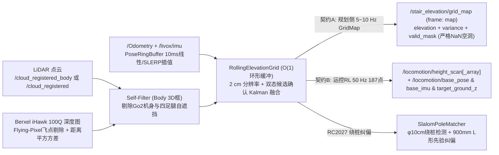

> [!abstract] 本文档定位
> 本文系统沉淀最近在 **`~/elevation_ws`** 与 **`~/agras_mid360`** 落地的全部自研精细化高程图成果（代码已推送至 `WGK1005/SLAM` 仓库的 **`elevation`** 独立分支），覆盖两大核心下游输出契约、核心架构源码映射、6 大实战血泪坑排查与 WSL2/实机速查指令。
>
> 🔗 关联总纲：[[00_SLAM全栈学习路径与建图项目总览]] · 雷达驱动档案：[[04_大疆览沃_Livox_Mid-360_全向固态激光雷达从零上手与避坑实战]]

---

## 一、整体代码架构（`WGK1005/SLAM` · `elevation` 分支）

为避免 ROS 2 `elevation_mapping_ros2` 臃肿包在边缘 CPU 端卡死、分辨率受限以及踩踏空洞被填平的致命隐患，我们自研了轻量级 C++17 实时高程建图节点 **`stair_elevation_mapper`** + 自定义消息 **`stair_elevation_msgs`**（[`HeightScan17x11.msg`](elevation_ws)），实测单帧积分 `< 5 ms`、`17×11` 子图采样 `< 0.5 ms`。



### 仓库核心文件索引（`elevation` 分支）
- **`src/stair_elevation_msgs/`**：`HeightScan17x11.msg`（含 `heights[187]`、`validity[187]`、`valid_ratio`、`base_z`、`min_overhang_clearance`、`overhang_detected`、`map_latency_ms`）。
- **`src/stair_elevation_mapper/include & src/`**：
  - `rolling_elevation_grid.*`：`4m × 4m @ 2cm`（`200×200`）$O(1)$ 环形缓冲区、`SelfFilterConfig`（机体 3D 自滤）、双态候选点确认（防飞点毛刺）、非对称孤立尖刺剔除、保留台阶锐利边界的多轮孔洞修补与双层悬空检测。
  - `height_scan_sampler.*`：`17×11 = 187` 点滚动子图采样器，支持 `patch_max`（`5×5 = 10cm` 无缝防漏极值）、`patch_percentile`、`bilinear` 与方向序契约切换。
  - `depth_projector.*`：Berxel 100Q `16UC1 / 32FC1 / PointCloud2` 深度投影、边缘腐蚀、飞点跳变过滤与降级检测。
  - `slalom_pole_matcher.*`：`φ100mm` 绕桩极值聚类与 `900mm` L 形先验匹配，输出漂移纠偏位姿。
  - `stair_elevation_node.cpp`：4 回调组多线程 ROS 2 主节点，锁存与位姿同源的精确整数纳秒时间戳。
- **`tools/` 保留工具链**：
  - `export_stair_elevation_2cm_map.py`：从实测 PCD 导出规划侧 `2cm` 高程包（NPZ + C++ 二进制 + YAML）。
  - `publish_stair_elevation_gridmap.py`：`5~10 Hz` ROS 2 `GridMap` 回放发布器（对齐 `/odom` 时钟）。
  - `inspect_height_scan.py`：终端实时打印 `17×11` 数值矩阵与中轴线相邻行 `dz` 跃变以核验台阶分界。
  - `pcd_stair_player.py`：静帧楼梯点云在线流式回放器。
  - `render_stair_3d_mesh.py`：ETH RSL / ANYmal 风格 `5cm` 3D 网格与落足点渲染器。
  - `build_height_scan_demo_html.py` & `stair_187_height_scan_demo.html`：单文件离线 3D 交互演示网页（固定世界坐标系 + 鼠标旋转缩放观察 `187` 点动态爬楼）。

---

## 二、两大下游接口契约（严格对齐规约）

### 契约 A：路径规划 / 落足点用 `2 cm` 精细高程图（`planner_elevation_2cm_map.yaml`）

| 规范项 | 工程实现与约定 | 为什么必须这样 |
|---|---|---|
| **分辨率 `≤ 2 cm`** | 严格 **`0.02 m`**（离线楼梯包 `233 × 73`，在线 `200 × 200`） | `RC 100mm` 绕桩在 `5cm` 栅格里仅 `2×2` 格，略微膨胀即消失；`Ø300` 必达区对中同样需要 `2cm` 尺度 |
| **核心图层** | `elevation` + `variance` + `valid_mask`（+ `inlier_count`） | 仅靠高度无法区分“已观测平地”与“未测到盲区”，必须附带方差与掩码 |
| **自身剔除** | `self_filter.enable: true`，机体 `base_link` 系 `3D Box` 过滤 | 狗踩砖木坑/轮胎抬腿时，机身与四足进入视野会被误当成障碍物导致自己绕自己 |
| **输出坐标系** | `frame_id: "map"`（世界场地坐标系） | 规划与位姿评估均在全局场地系完成 |
| **空洞语义** | 关闭盲填（`enable_hole_fill: false`），**严格 `NaN` + `valid_mask=0`** | 绝不允许把未观测空洞填成 `0 m`，否则规划器会把黑洞当平地穿过去 |
| **时间戳对齐** | 锁存 `odom` 原始 `sec/nanosec`，直接写入 `GridMap` header/info | 保证局部轨迹代价计算与里程计位姿零漂移对齐 |
| **更新频率** | `output.grid_map_hz: 8.0`（`5~10 Hz` 区间） | 满足动态规划且避免 CPU 被高分辨率全图序列化拖垮 |

> [!example] 已导出的第一段楼梯 `2 cm` 数据包实测指标（`outdoor_1122_1949/stair_elevation_2cm_map`）
> - **栅格尺寸**：`233 × 73 @ 0.02 m`（`X ∈ [1.80, 6.46] m, Y ∈ [-1.60, -0.14] m`）
> - **有效覆率**：`15,250 / 17,009 (89.7%)`，其余 `10.3%` 未观测孔洞 100% 保持 `elevation=NaN, variance=NaN, valid_mask=0`
> - **高程与方差**：`z_floor = -0.257 m`，高程跨度 `[-0.289, 1.850] m`，平地面中位方差 `0.0001 m²`（台阶立面自然呈现 `25~45 mm` 高标准差，天然区隔踏面与立面）

![[stair_elevation_2cm_preview.png]]

---

### 契约 B：运控 RL Student 多任务 `50 Hz` `187` 点高程契约（`rc_student_mid360_100q.yaml`）

1. **话题集合**（通过 `/home/wgk/agras_mid360/tools/verify_student_contract.py` 一键验真）：
   - `/locomotion/height_scan` (`stair_elevation_msgs/HeightScan17x11`) & `/locomotion/height_scan_array` (`Float32MultiArray`)
   - `/locomotion/base_pose` (`Odometry`)、`/locomotion/base_imu` (`Imu`，`50 Hz` 融合 Mid-360 内置 IMU 角速度与重力投影)
   - `/locomotion/target_ground_z` (`Float32`，基于目标点邻域平坦块估算，用于计算策略 `height_error`)
2. **索引与数值契约**：
   - **数组索引**：`row_major: false`，`Y` 外层（`-0.5 .. +0.5 m`，11 点）、`X` 内层（`-0.8 .. +0.8 m`，17 点），`index = iy * 17 + ix`。
   - **高度公式**：`h = clip((base_link_z - terrain_z) * 0.2, -1.0, 1.0)`；未观测或超 `5.0 m` 光线距离统一填 **`miss_value = 1.0`**。
   - **启动归零**：`floor_zero.enable: true` + 原地盲区高方差地面先验（`footprint 0.45 × 0.30 m`），保证站立原地起步瞬间足底盲区不报悬崖。
3. **RC 2027 复合障碍实测验证**：在 `0.02 m` 下搭配 `patch_max`（`5×5 = 10 cm`），`φ100mm` 绕桩、`80mm` 矮墙、与 `290mm` 限高框双层净空全部清晰检出。

![[rc_2027_elevation_slalom_overhang_demo.png]]

---

## 三、血泪排坑录（实战关键经验）

1. **绝对不要把未测空洞默认填成 `0 m`**：早期为了画面好看做激进孔洞填充，结果梯面分界被抹成平滑斜坡、且盲区被误判成平坦路面。正确做法是：**规划侧严格用 `NaN + valid_mask=0` 标记空洞，RL 侧按训练分布显式填 `miss_value = 1.0` 并附带 `validity` 比率监控**。
2. **“图像看不出台阶分界 ≠ 数据没分界”**：RViz 里 `viridis` 或小范围台阶（`14~16 cm`）在视角斜切时容易视觉扁平，必须直接看 187 点矩阵数值！用 `inspect_height_scan.py` 打印中轴线相邻 `10 cm` 行的 `dz_center` 跃变，可以直接确认每步约 `-0.115 ~ -0.15 m` 的真实台阶阶跃与 `valid_ratio=100%`（实测延迟 `< 50 ms`）。
3. **空洞往往来自走得太快，而非建图器丢点**：Mid-360 / Mid-70 是非重复扫描，单帧覆盖稀疏。走慢一点或多停顿 0.5 秒积帧，局部空洞会自然消散；同时关闭离线预建图 PCD 的 `enable_ray_cleanup`，防止误把踏面当作瞬态障碍射线擦除。
4. **浮动噪点的根因与切除**：点云上方漂浮噪点多来自楼梯间斜顶天花板回波和台阶锐边飞点（Flying Pixels）。通过 `max_rel_z = 0.50~0.65` + `max_rel_z_slope = 0.42~0.50` 随前向距离渐进放宽（既保留 `23°` 上行楼梯，又彻底切掉斜顶），再配合深度图飞点跳变过滤（`0.04 m`）和双态候选确认即可根治。
5. **下蹲过限高框时 `self_filter.min_z` 陷阱**：Go2 蹲姿钻 `290 mm` 限高框时，机身离地高度骤降。若 `self_filter.min_z` 仍设为常规站立 `-0.45 m`，会把脚下真实地面一起剔除！因此在 `rc_student_mid360_100q.yaml` 中特意收紧为 `min_z: -0.22 m` 专防误杀地面。
6. **必须锁存位姿同源整数纳秒时钟**：绝对禁止在 `GridMap` 发布回调里直接调用 `node->now()` 充当时间戳，否则下游查 TF 或计算运动代价值时会出现时钟基准错位；必须直接保存并复用里程计 `msg->header.stamp`。

---

## 四、WSL2 / 实机常用指令速查

### 1. Mid-360 解锁与快速启动（`~/agras_mid360`）
```bash
# 1) 网卡(192.168.1.20) 与 UDP 60001/60003 端口自检
bash /home/wgk/agras_mid360/probe_agras.sh

# 2) 一键解锁 360° 全周扫描 + RViz2 查看点云 / 建图
bash /home/wgk/agras_mid360/run_agras.sh view
bash /home/wgk/agras_mid360/run_agras.sh mapping

# 3) 启动 RC2027 Student 50Hz 187点全栈感知 + 契约验真
bash /home/wgk/agras_mid360/run_rc_student_perception.sh --lidar-only --viz
python3 /home/wgk/agras_mid360/tools/verify_student_contract.py
```

### 2. 高程图编译测试、离线回放与规划图交付（`~/elevation_ws`）
```bash
# 1) 编译 + 跑全部 12 项 GTest（含自滤与10cm绕桩测试）
cd /home/wgk/elevation_ws && source /opt/ros/humble/setup.bash
colcon build --packages-select stair_elevation_mapper
ctest --test-dir /home/wgk/elevation_ws/build/stair_elevation_mapper --output-on-failure

# 2) Mid-70 楼梯 PCD 在线 2cm 建图回放 + 终端 187 点台阶跃变检查
bash /home/wgk/elevation_ws/replay_mid70_stairs_1122.sh
python3 /home/wgk/elevation_ws/tools/inspect_height_scan.py

# 3) 导出并 8Hz 发布规划侧 2cm GridMap（严格 NaN 空洞）
python3 /home/wgk/elevation_ws/tools/export_stair_elevation_2cm_map.py
python3 /home/wgk/elevation_ws/tools/publish_stair_elevation_gridmap.py --hz 8.0 --standalone-clock

# 4) 浏览器打开 187 点动态爬楼 3D 交互网页（可鼠标拖拽视角、世界坐标系固定）
xdg-open /home/wgk/elevation_ws/tools/stair_187_height_scan_demo.html
```
